# 진입 차량 대응 — 규칙 보완

## 요약

**합의 사항 → 상태**

- [완료] 지난 보고서에서 남은 과제였던 **정본(B)의 실패 17건**을 분해하고, 규칙을 세 가지 더 보완함
- [완료] 보완 후 **충돌 30건 → 10건**, 실패율 4.5% → **1.5%**. 새로운 충돌 건은 **0건** -> 기존에 잘 처리하던 시나리오에는 영향을 주지 않음.

**이번 결과 / 다음**

- 결과: 규칙 보완만으로 **충돌 30건 → 10건**. 정책·학습은 전혀 건드리지 않았고 체크포인트도 같음(it3200)
- 결과: 추종 지표는 변화 없음(횡 0.126 → 0.128 m). **안전을 얻으면서 추종을 잃지 않음**
- 결과: **남은 10건은 전부 물리적 한계** — 진입차가 보이기 시작한 시점에 이미 제동으로도 통과로도 풀 수 없는 조건

---

## 1. 설계

### 1.1 4-arm 정의

제어기는 **BC 조향 + PID(비례·적분·미분) 스로틀**이고, 그 위에 RL 잔차와 안전 규칙이 얹힘.

| arm | RL 잔차 | 안전 규칙 | 구성 |
|---|---|---|---|
| **A** | O | X | BC + PID + RL 잔차 |
| **B** | O | O | BC + PID + RL 잔차 + 안전 규칙 |
| **C** | X | O | BC + PID + 안전 규칙 |
| **D** | X | X | BC + PID 만 |

- **정책은 4-arm 전부 같음**(정본 `hz_q`, 체크포인트 it3200). 이번 보고서에서도 정책은 그대로이고 **규칙만 바뀜**

### 1.2 안전 규칙

```
v_allow    = √(2 · 3.0 · (d − 3))        d = 교차 지점까지 거리, 3 m 앞에 정지
brake_rule = clamp(0.6 · (v − v_allow), 0, 1)
brake      = max(정책 제동, brake_rule)
```

교차점 3 m 앞에 세우는 것을 기준 했을 때:

| 교차점까지 | 50 m | 30 m | 20 m | 10 m | 5 m | 3 m |
|---|---|---|---|---|---|---|
| v_allow | 60 km/h | 46 km/h | 36 km/h | 23 km/h | 12 km/h | 0 |

- 부딪힐 수 있는 상황에서 주행 차량의 속도가 v_allow(교차점 3 m 앞에 멈출 수 있는 속도)를 넘지 않도록 brake = max(RL 정책 제동, brake_rule)로 강제로 제한함.

### 1.3 규칙 수정사항

지난 보고서(8월 21일)에서 **①②** 두 가지를 넣었고, 이번에 **③④⑤** 세 가지를 더 넣음. 

| | 21일 규칙 | **이번 추가** |
|---|---|---|
| ① 정지 지점 `d` | 동적 정지선 — 진입차 예측 궤적과의 거리가 3 m 아래로 내려가는 첫 지점 | 그대로 |
| ② 통과 판정 | 지금 선 자리가 이미 진입차 진로 안이면 세우지 않음 | 그대로 |
| **③ 통과 시 가속** | — | 통과하기로 판정하면 해당 경로의 목표 속도를 **기준속도 + 6 m/s**로 올림 |
| **④ 딜레마 구간 조향 허용** | — | 설 수도 갈 수도 없으면 조향 억제를 **품** |
| **⑤ 통과 중 제동 차단** | — | 설 수 없고 갈 수는 있으면 **정책 제동을 막음** |

**③ 통과 시 가속** — 21일 규칙의 통과 판정(②)은 **규칙 제동을 풀어 줄 뿐**이라 이미 잃은 속도가 돌아오지 않음. 판정이 "먼저 간다"인데 속도가 낮으면 통과를 못 끝냄. 그래서 판정과 동시에 목표 속도를 올림(기준속도 + 6 m/s, 기준 대비 초과 상한도 6 m/s). 단, 최고 속도는 100km/h까지

**④ 딜레마 구간 조향 허용** — 안전 규칙은 "양보는 제동으로 푸는 문제"라는 전제로 진입차 접근 중 조향 잔차 확대를 끔. 그런데 **설 수도 갈 수도 없는 구간에서는 그 전제가 성립하지 않음** — 조향이 유일하게 남은 행동임. 이 구간에서만 억제를 풀어 정지 장애물과 같은 취급을 함.

**⑤ 통과 중 제동 차단** — `brake = max(정책, 규칙)`이라 규칙을 풀어도 **정책이 혼자 밟으면** 속도를 잃음. 실측에서 통과 도중 4.40 → 2.10 m/s로 떨어져 그것이 진입 차의 뒷범퍼 충돌로 이어짐. 설 수 없고 갈 수는 있는 구간에서 정책 제동을 막음.

---

## 2. 평가 조건

| 축 | 값 | 개수 |
|---|---|---|
| 자차 경로 | 저속 3(circle, figure8, serpentine) + 고속 3(69·90·90 kph) | 6 |
| 진입 유형 | 직각 90° · 대각선 45° · 곡선 진입 ±20° | 4 |
| 시작점에서 교차점까지 거리 | 60 m · 200 m | 2 |
| 시야 | 80 · 40 · 20 · 12 m | 4 |
| 간격 | −40 · −24 · 0 · +24 · +40 m | 5 |
| 진입차량 속도 | 4 · 8 · 12 · 16 · 22 m/s | 5 |

- **시야**: 차량이 진입 차량을 판단하기 시작한 거리
- **간격**: 자차가 교차점에 도착한 순간 진입차가 교차점까지 남겨둔 거리. - ex) +40: 자차가 교차점을 지날 때 진입차가 아직 교차점까지 40 m 남음, 0: 진입차도 같은 순간 교차점 도착, -40: 진입차가 이미 교차점으로부터 40 m 지나감

### 2.1 실패 기준

지난 보고서에서 조향 회피 부분 수정 cte 1.0 m -> 3.22 m. 충돌만 세면 **안 부딪혔지만 잘못 푼 경우**가 성공으로 잡히므로 세 가지를 실패로 셈.

| | 판정 | 근거 |
|---|---|---|
| **충돌** | 접촉 발생 | — |
| **조향 회피** | 감속 < 2.0 m/s **이면서** 회피 구간의 조향 잔차가 **평소의 2배 이상**(그리고 0.10 이상) **이면서** 그 결과 **평소보다 3.22 m(차폭을 고려한 물리적 하한선 그 이하는 충돌함) 이상 더 벌어짐** | 사전에 인지했을 때 정지한 물체가 아닌 움직이는 차량을 조향으로 틀어 피하는 것은 합리적이지 못함 |
| **극단 과속** | 위험 구간 최고 속도 **100 km/h 이상** | 우리 경로의 최고 설계 속도가 90 km/h. 그보다 11% 위 |

**실패로 세지 않는 것**: 단순한 조향 변화, 먼저 통과하기 위한 완만한 과속, 딜레마 존에서의 조향 회피

---

## 3. 결과

### 3.1 표 1 — arm 별 (it3200)

분모는 **대응 필요 660셀**.

| arm | RL | 규칙 | 충돌 | 충돌률 |  횡 m | 속도 m/s |
|---|---|---|---|---|---|---|
| **A** RL만 | O | X | 384 | 58.2% | **0.061** | **0.062** |
| **B** RL+규칙 (21일) | O | O | 30 | 4.5% | 0.088 | 0.065 |
| **B′** RL+규칙 (**이번**) | O | O | **10** | **1.5%** |  0.090 | 0.066 |
| **C** 규칙만 | X | O | 63 | 9.5% | 5.961 | 1.932 |
| **D** 기본 제어기만 | X | X | 551 | 83.5% |  4.546 | 1.754 |

- **충돌 30 → 10건.** 규칙만 바꿨고 정책·체크포인트는 동일함
- **추종 지표는 사실상 그대로**(횡 0.088 → 0.090 m). 안전을 얻으면서 추종을 잃지 않음


### 3.2 실패 — 충돌 + 조향 회피 + 극단 과속

| arm | 충돌 | 조향 회피 | 극단 과속 | **실패** | **실패율** | 경로 추종 발산 |
|---|---|---|---|---|---|---|
| **A** RL만 | 384 | **2** | 0 | 386 | **58.5%** | 27 |
| **B** RL+규칙 (21일) | 30 | **0** | 0 | 30 | **4.5%** | **0** |
| **B′** RL+규칙 (**이번**) | **10** | **0** | 0 | **10** | **1.5%** | **0** |
| **C** 규칙만 | 63 | **0** | **3** | 66 | **10.0%** | **595** |
| **D** 기본 제어기만 | 551 | **0** | 0 | 551 | **83.5%** | **107** |

- **실패율 4.5% → 1.5%.**


### 3.3 남은 10건 — 전부 물리적 한계

| 유형 | 건수 | 평균 충돌 속도 | 성격 |
|---|---|---|---|
| **시야 12 m** | **8** |  0.47 m/s | 관측 한계 |
| **직각횡단 · 시야 40 m** | **2** |  0.19 m/s | 관측 한계 |

**10건 전부가 관측 한계임.** 차량이 판단할 시간이 너무 적어 어떠한 판단을 해도 부딪힘. 위 건들은 모두 멈추는 판단을 했지만 충돌함.

**직각횡단 2건의 예 (4-4)** — 시야는 40 m지만, 진입차가 22 m/s로 달려와 40 m 반경에 들어오는 순간이 이미 도착 직전이고, 그때 자차는 교차점 **4.53 m 앞**에 속도 4.59 m/s로 있음.

| 선택지 | 필요한 것 | 가진 것 | 결과 |
|---|---|---|---|
| **선다** | 제동거리 1.75 m + 정지 여유 3.00 m = **4.75 m** | 교차점까지 **4.53 m** | **0.22 m 모자람.** 서긴 서지만 **차 앞부분이 진입차 진로에 남음** |
| **간다** | 진로를 완전히 빠져나가는 데 **11.08 m**, 가속해도 **2.66초** | 진입차가 진로를 지나기까지 **0.37초** | **2.29초 모자람** |

- **실제로 통과를 시켜 봤을 떄.** 규칙 제동을 차단해 그냥 가게 하니 **4.09 m/s로 측면 충돌**함.


---

## 4. 주행 영상

네 장면 모두 **21일 규칙**과 **이번 정본**을 같은 조건으로 비교함.

| 장면 | 조건 | 21일 규칙 | 이번 정본 |
|---|---|---|---|
| ① 대표 충돌 개선 1 | figure8, 대각선 45°, 간격 +24 m, 진입 8 m/s, 시야 80 m | 충돌 | **회피** |
| ② 대표 충돌 개선 2 | serpentine, 직각 90°, 간격 +40 m, 진입 16 m/s, 시야 80 m | 충돌 | **회피** |
| ③ 물리적 한계 — 시야 12 m | serpentine, 곡선 진입 +20°, 동시 도달, 진입 16 m/s, 시야 12 m | 충돌 | 충돌 |
| ④ 물리적 한계 — 직각횡단 40 m | serpentine, 직각 90°, 간격 +24 m, 진입 16 m/s, 시야 40 m | 충돌 | 충돌 |


### ① 대표 충돌 개선 1  — figure8, 대각선 45°, 간격 +24 m, 진입 8 m/s, 시야 80 m


| | 충돌 | 기준 대비 감속 | 제동 최대 | 횡 이탈 최대 | 충돌 시 자차 속도 |
|---|---|---|---|---|---|
| 21일 규칙 | **O** | 18.0 km/h | **1.00** | 0.31 m | 5.7 m/s |
| **이번 정본** | X | **10.6 km/h** | **0.38** | 0.31 m | —  |


- **살린 것은 ⑤(통과 중 제동 차단)임.** `설 수 없고 갈 수는 있음`이 성립한 순간 제동이 정확히 0이 되고 속도가 **4.82 → 6.54 m/s**로 회복되어 빠져나감.   
``-> 안전 지향을 위해 설계를 자체를 진입 차량을 확인 한 순간 교차점 부근까지 속도를 어느정도 감속하다가 완전히 정지할지 통과할지를 결정하도록 하여서 속도 회복이 필요``


| 21일 규칙 | 이번 정본 |
|---|---|
| 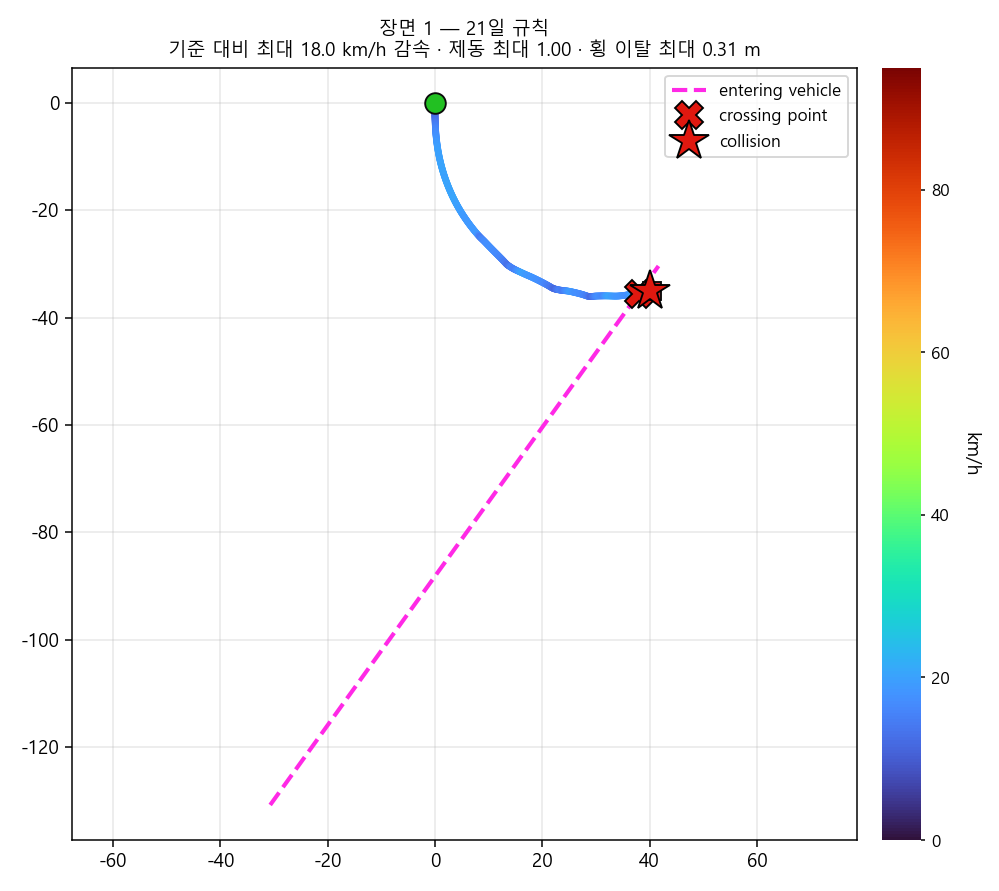 | 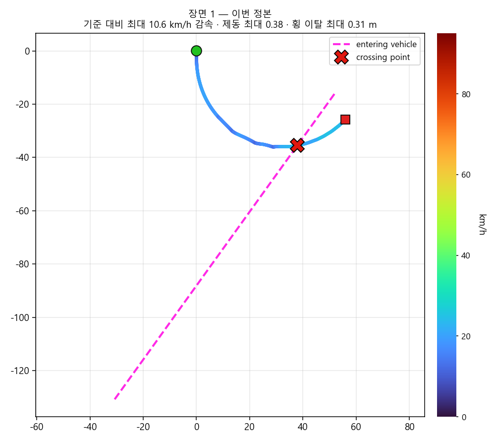 |

**영상** — 썸네일을 누르면 파일로 이동함. 파일은 `video_jw/r25_s1_*.mp4`

| 21일 규칙 | 이번 정본 |
|---|---|
| [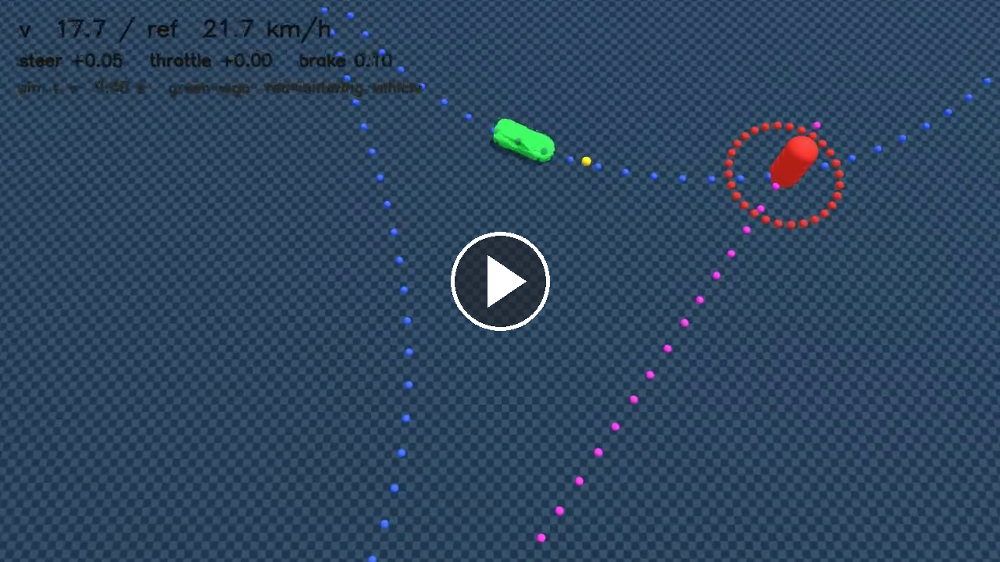](https://github.com/user-attachments/assets/29ff1254-15a3-46dd-9dba-79fbdfd93a0f) | [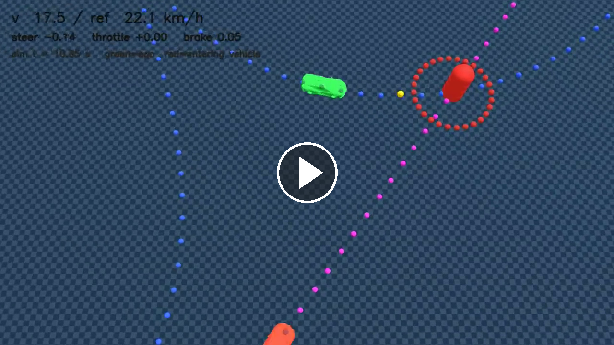](https://github.com/user-attachments/assets/12308854-5d74-4001-ba42-0c236dfb9bf4) |

### ② 대표 충돌 개선 2 — serpentine, 직각 90°, 간격 +40 m, 진입 16 m/s, 시야 80 m


| | 충돌 | 기준 대비 감속 | 제동 최대 | 횡 이탈 최대 | 충돌 시 자차 속도 |
|---|---|---|---|---|---|
| 21일 규칙 | **O** | 14.1 km/h | 0.66 | 0.36 m | 1.7 m/s |
| **이번 정본** | X | **5.8 km/h** | **0.38** | 0.36 m | —  |

- 같은 구조임. 21일 규칙은 14.1 km/h를 줄였다가 **1.7 m/s까지 느려진 채로** 받힘
- 이번 정본은 5.8 km/h만 줄이고 지나감.

| 21일 규칙 | 이번 정본 |
|---|---|
|  | 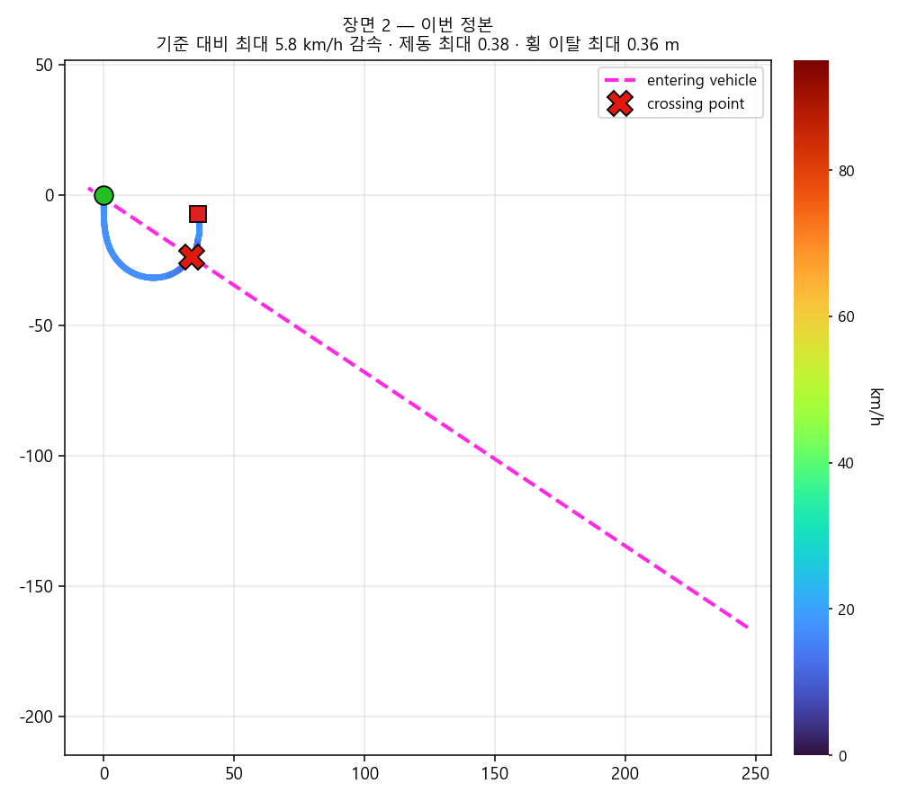 |

**영상** — 파일은 `video_jw/r25_s2_*.mp4`

| 21일 규칙 | 이번 정본 |
|---|---|
| [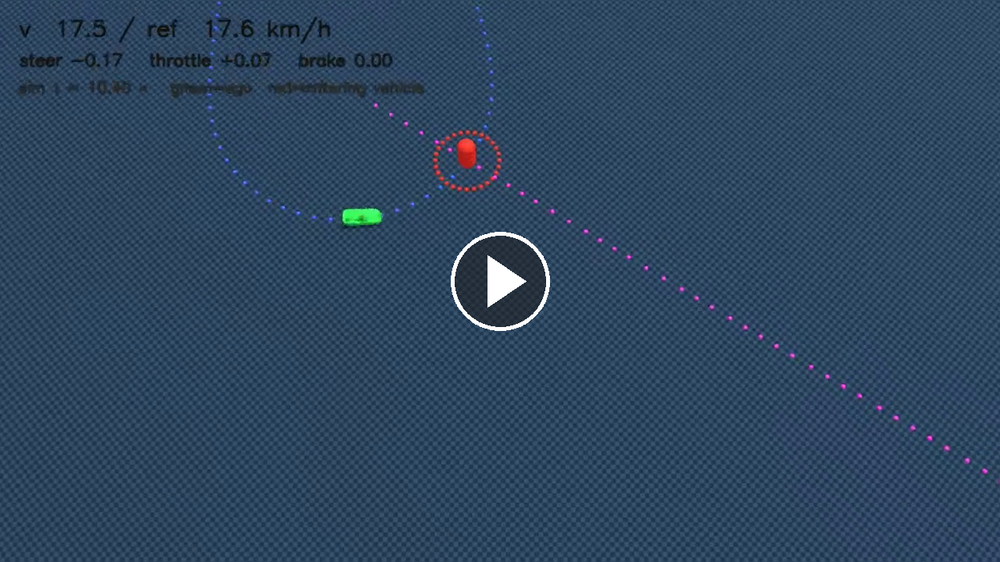](https://github.com/user-attachments/assets/831dc505-c97e-4edf-a2b1-43577b23f4c5) | [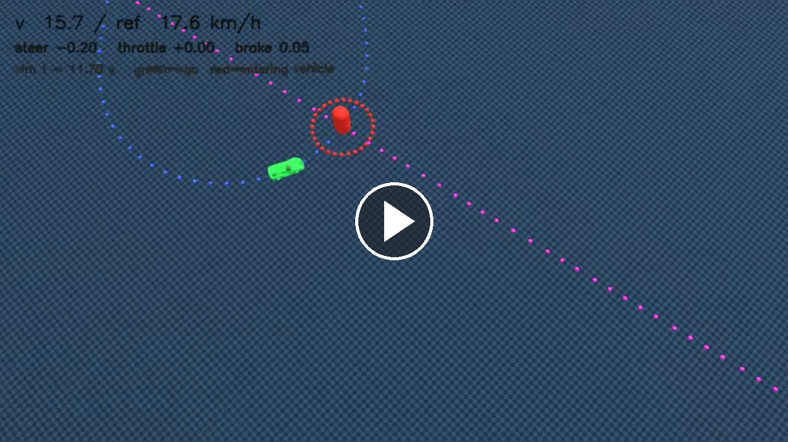](https://github.com/user-attachments/assets/35e5b948-7239-445f-b1de-091cf0afc294) |

### ③ 물리적 한계 — 시야 12 m, serpentine, 곡선 진입 +20°, 동시 도달, 진입 16 m/s

| | 충돌 | 기준 대비 감속 | 제동 최대 | 횡 이탈 최대 | 충돌 시 자차 속도 |
|---|---|---|---|---|---|
| 21일 규칙 | **O** | 16.9 km/h | **1.00** | 0.36 m | **0.2 m/s** |
| **이번 정본** | **O** | 16.8 km/h | **1.00** | 0.36 m | **0.2 m/s** |

- 시야가 좁아 차량이 판단할 시간이 너무 적어 어떠한 판단을 해도 부딪힘.

| 21일 규칙 | 이번 정본 |
|---|---|
|  | 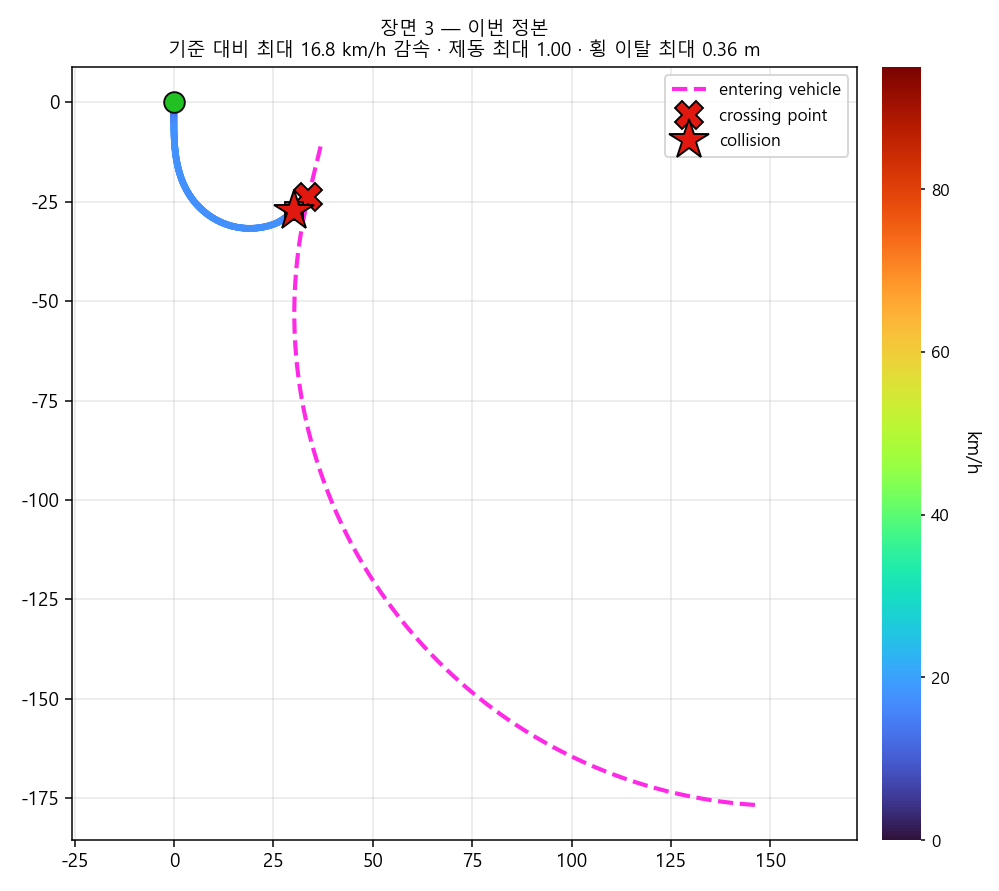 |

**영상** — 파일은 `video_jw/r25_s3_*.mp4`

| 21일 규칙 | 이번 정본 |
|---|---|
| [](https://github.com/user-attachments/assets/1b5cbc3a-f5ea-420b-9372-ac99fedbd96a) | [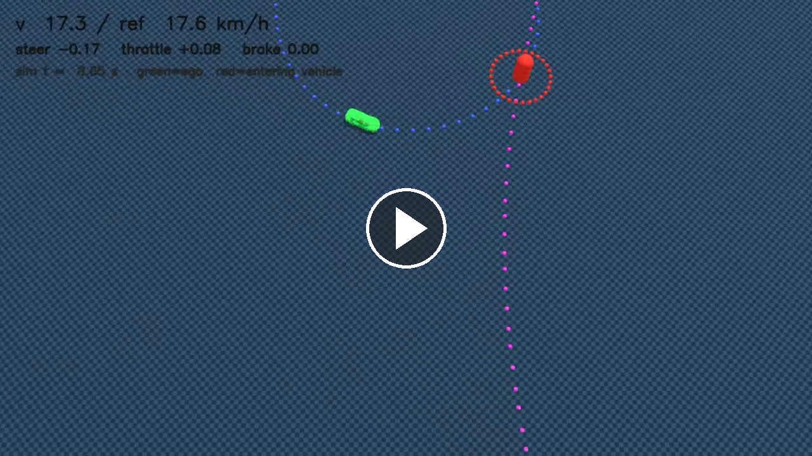](https://github.com/user-attachments/assets/3be737e2-5314-4e74-9b99-94b219f547ab) |

### ④ 물리적 한계 — 직각횡단 시야 40 m, serpentine, 간격 +24 m, 진입 16 m/s

| | 충돌 | 기준 대비 감속 | 제동 최대 | 횡 이탈 최대 | 충돌 시 자차 속도 |
|---|---|---|---|---|---|
| 21일 규칙 | **O** | 17.2 km/h | **1.00** | 0.36 m | **0.2 m/s** |
| **이번 정본** | **O** | 17.2 km/h | **1.00** | 0.36 m | **0.2 m/s** |


| 21일 규칙 | 이번 정본 |
|---|---|
| 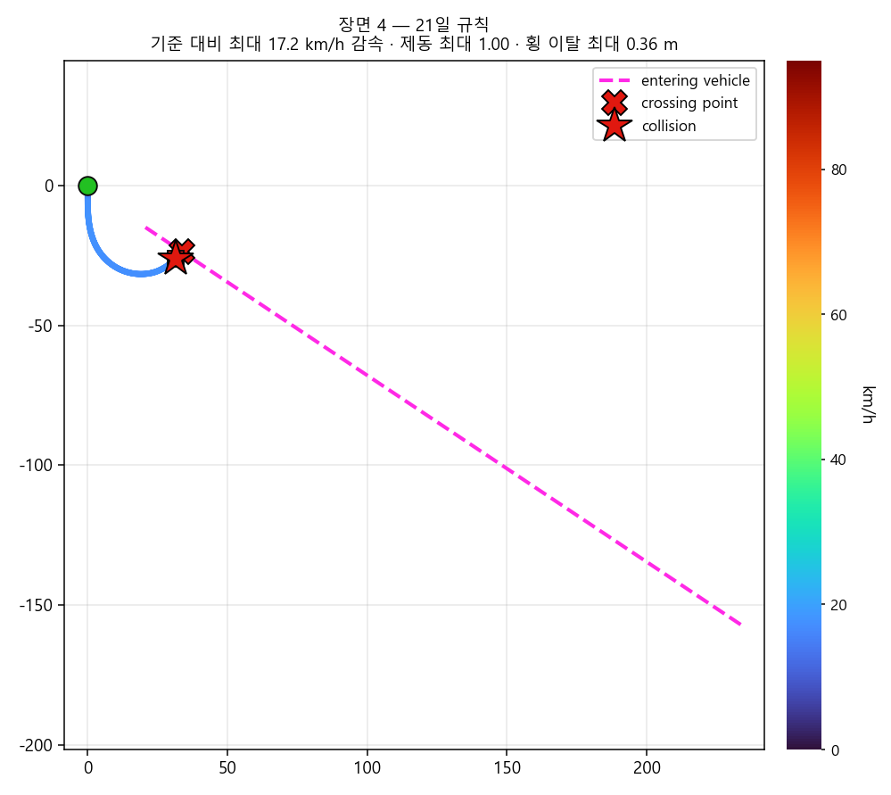 | 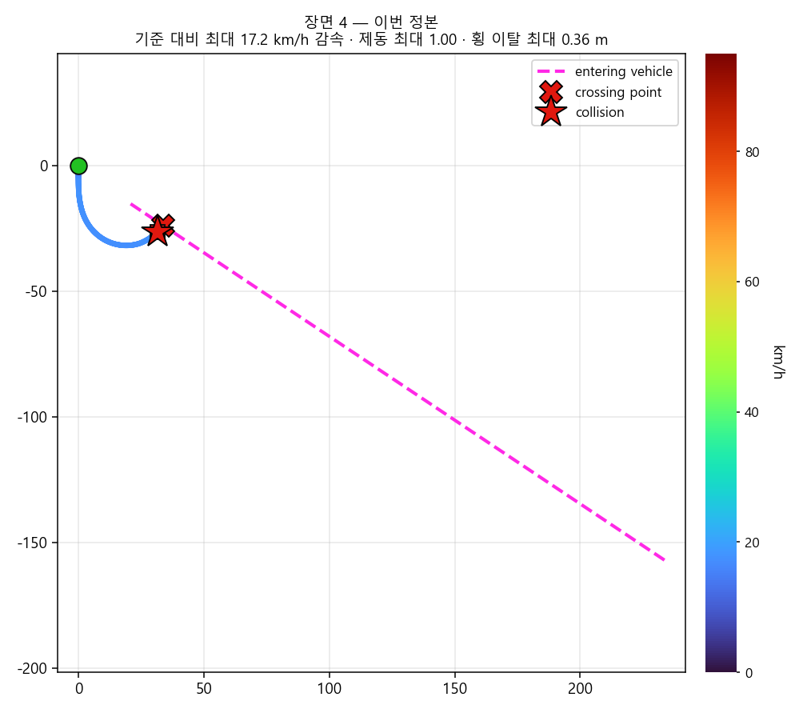 |

**영상** — 파일은 `video_jw/r25_s4_*.mp4`

| 21일 규칙 | 이번 정본 |
|---|---|
| [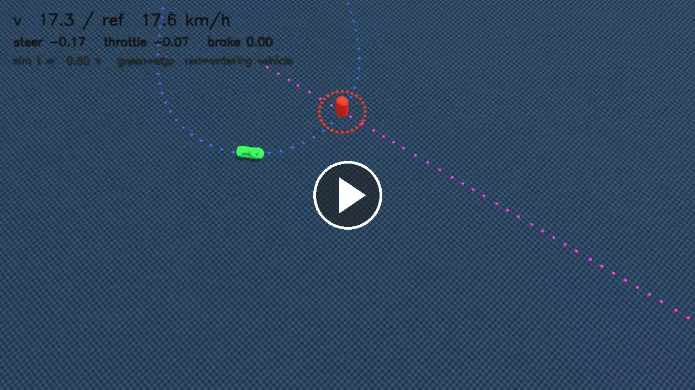](https://github.com/user-attachments/assets/38222e4d-333f-4c91-996c-85403b4720b0) | [](https://github.com/user-attachments/assets/bc354f26-8167-41e0-bf1b-87c6a0b581d1) |


---

## 5. TODO

- 알파마요 설치 및 VLA 도입
