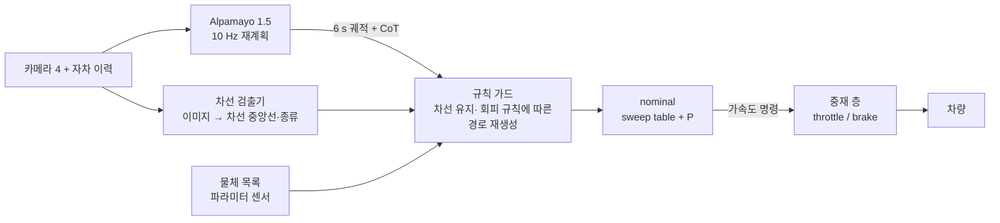
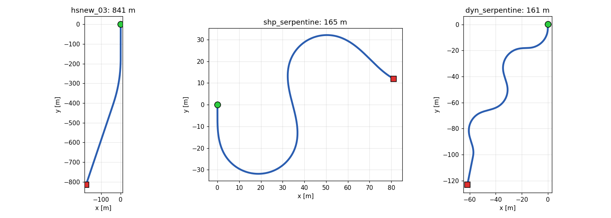
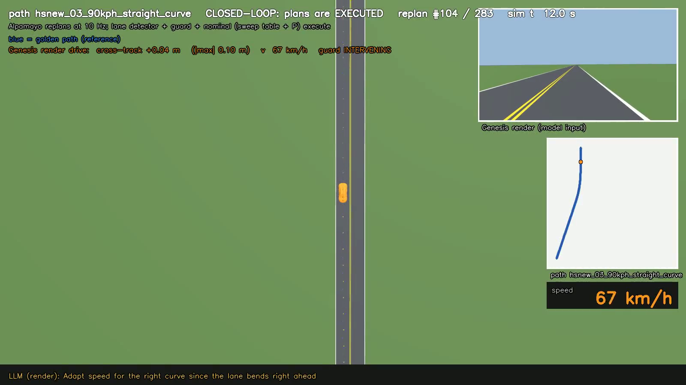
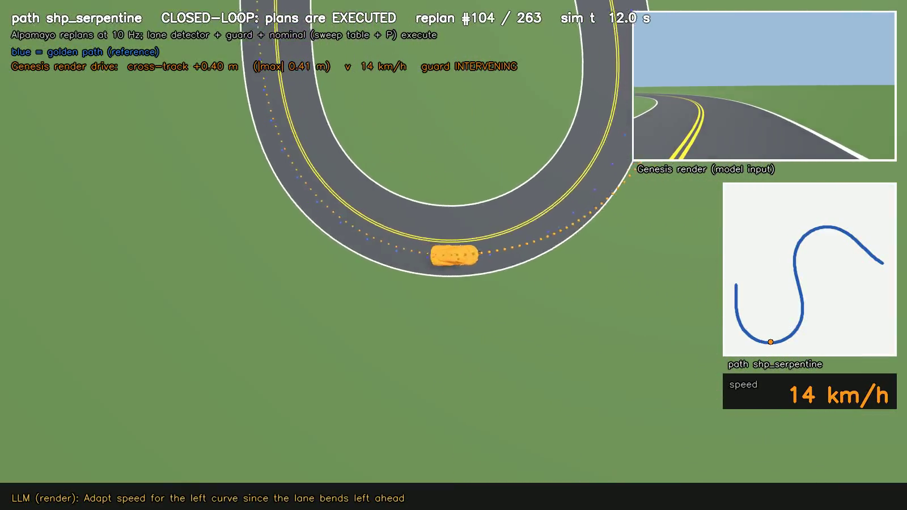
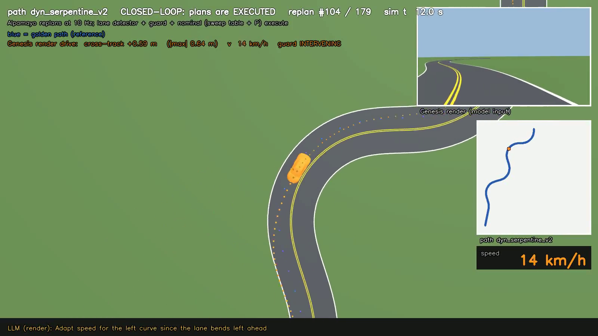
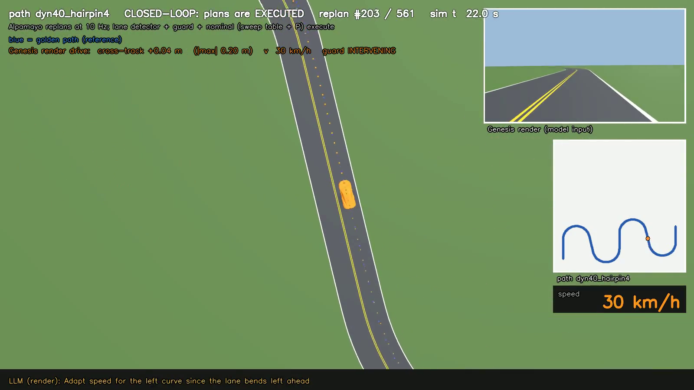
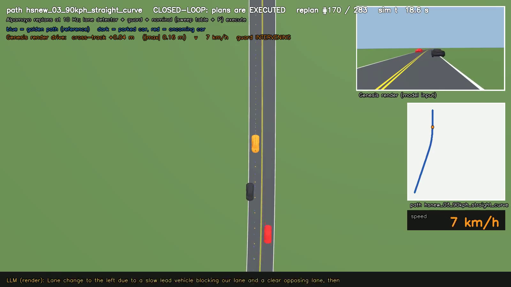
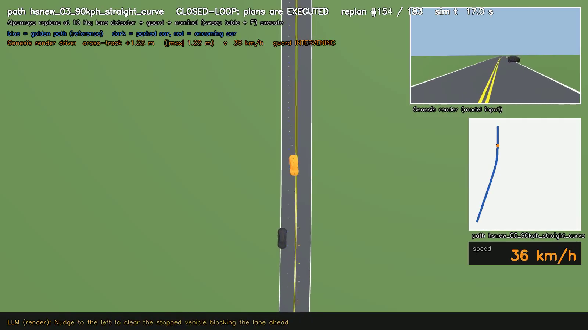

# VLA 플래너 + nominal 제어 + 규칙 가드 — 파이프라인 재구성

## 요약 (10줄 이내)

**지난 지시**
- BC 제어 대신 **nominal(sweep table + P 제어)** 로 바꾸고 Alpamayo 검증을 다시 할 것

**합의 사항 → 상태**
- [완료] BC → nominal 전환, Alpamayo 폐루프 재검증
- [완료] 차선 검출기 + 규칙 가드(경계·정지 장애물·대향 차량), 브레이크 채널
- [미착수] RL — 규칙으로 못 푸는 최소 범위가 확인되면 그때만 (사유: 2.3절)

**이번 결과 / 다음**
- 결과: Alpamayo 계획은 차선을 **66~99 %** 넘지만 실제 주행차는 **0 %**(3경로). 정차 차량 + 대향 차량 4셀 **충돌 0 / 7**
- 결과: 헤어핀 경로(64 s, 456 m) 주행 cte 평균 **0.113 m**, 최대 **0.291 m**, 월선 **0 %** (3.1절 영상)
- 다음: 이동 차량·비차량 물체 규칙 

---

## 1. 전체 구조

기존 **Alpamayo(planner) → Path2st(BC 조향 + PID 속도) → Safety Shield(진입 차량 STOP / PASS)** 에서 아래와 같이 변경.

| 단계 | 기존 (① → ② → ③) | 현재 (① → ③ → ② → ④) | 바뀐 이유 |
|---|---|---|---|
| ① 계획 | Alpamayo 1.5 planner, 2 s 주기 재계획 | Alpamayo 1.5, **0.1 s 주기 재계획**, 실제 카메라 모델(f-theta + 장착 자세)로 렌더 | Alpamayo 학습 데이터를 만드는데 사용된 카메라 모델과 동일해야 Alpamayo 계획에 유리할 것이라 판단|
| ③ 안전 규칙 | Safety Shield: **진입 차량 STOP / PASS** 만. **제어 뒤**에서 페달을 덮어씀 | 진입 차량 + **차선 유지 + 정지 장애물 + 대향 차량**, 차선 검출기 추가. **제어 앞**에서 계획을 고쳐 넘김 | 경로 계획의 66~99 % 가 차선을 넘음(2.1절). 페달을 덮어쓰는 대신 계획을 고치면 제어기가 부드럽게 따라감 |
| ② 제어 (Path2st) | **BC 조향 + PID 속도** → 스로틀·조향 직접 출력 | **nominal** = sweep table + P (횡·시간추종) → 조향 + **목표 가속도(m/s²)** 출력 | 기존 mppi 골든 추출로 BC를 사용했지만 sweep으로 바뀌면서 BC의 이유가 사라짐 |
| ④ 중재 층 | - |  a ≥ 0 이면 throttle sweep table 로 throttle 값을 역산하고, a < 0 인데 throttle을 떼고 저항으로 감속하는 것만으로 부족하면 brake sweep table로 brake 값을 역산 | brake를 맡던 RL 잔차 층을 없앰 → brake sweep table 을 새로 측정해 throttle 표 옆에 두고, 두 표 중 어느 쪽을 쓸지 정하는 층이 필요 |

- 기존에 없던 brake sweep table 을 새로 측정해 추가
- **가드는 위반할 때만 개입.** 계획이 차선 경계를 넘거나 물체 규칙에 걸리면 검출 차선 중앙으로 기준을 다시 만들고 속도 상한을 건다. 평소엔 계획 그대로.

---

## 2. 규칙

### 2.1 차선 유지 Alpamayo 단독으로는 부족

| 경로 | Alpamayo 계획이 차선을 넘는 비율 | 실제 차 월선 (가드 ON) | cte 평균 / 최대 | 주행 영상 (클릭) |
|---|---|---|---|---|
| hsnew_03 | 66.2 % | **0 %** | 0.044 / 0.100 m |  |
| shp_serpentine | 79.5 % | **0 %** | 0.288 / 0.507 m |  |
| dyn_serpentine | 99.4 % | **0 %** | 0.374 / 0.645 m |  |

- 현재 Alpamayo 단독으로는 차선 유지가 어렵지만 가드로 해결 -> 하지만 가드의 개입률이 너무 커 RL로 계획 단계에서 보정 필요(TODO) 

### 2.1.1 차선 검출기

| 검출기 | 완만한 경로 오차 | 급커브 경로 오차 | 종류(점선·색) | 
|---|---|---|---|
| 색 규칙 (흰색, 노란색)| 0.05 m | 0.20 m | 규칙으로 |
| HybridNets(BDD100K 공개 학습망) | 0.03 m | 0.23 m | 규칙으로 |

- 현재 HybridNets 사용 중 -> 하지만 차선의 종류는 구분하지 못해 동일하게 규칙으로 처리해야 함.
- 차선 종류 판별까지 되는 검출기는 OpenLane 계열 검토 필요

### 2.2 정지 장애물도 규칙으로

VLA 스택에서는 진입 차량 규칙과 같은 방식으로 **규칙**으로 통일:

| 규칙 | 조건 | 행동 |
|---|---|---|
| ① 치우침 보존 | 전방 정지 물체가 차선 안에 걸침 | Alpamayo 의 비켜 가는 계획을 지우지 않고 물체 여유(0.5 m)만 강제 |
| ② 차선 안 통과 | 여유 폭 ≥ 0.5 m| 차선 안에서 통과 |
| ③ 월선 통과 | 여유 폭 < 0.5 m, 대향 차량 통과 여유 ≥ 4 s (월선 중단 < 2 s) | 필요한 만큼만 월선, 월선 중 통과 여유가 2s 아래로 떨어질 시 월선 중단 후 차선 복귀 |
| ④ 정지 연계 | 차선 안·월선 모두 불가 | 물체 12 m 앞 정지, 대향차 통과 후 2 m/s 로 비켜 출발 |

- **규칙으로 옮긴 이유**: 실차 스택(NVIDIA DRIVE, RSS 류)도 안전 제약은 규칙 층이 강제.  
- **RL 의 자리(TODO)**: 실차 스택처럼 학습은 **계획 단계**에, 제어·안전 제약은 규칙에 둔다. 다음 단계에서 Alpamayo 궤적 → **학습 보정기** → 가드 순으로 넣어 계획의 퀄리티를 높여 규칙 가드 개입률(2.1절)을 줄임.

---

## 3. 결과 및 주행 영상

### 3.1 차선 유지 — 헤어핀 경로

| | cte 평균 / 최대 | 월선 | 계획 월선 | 브레이크 사용 | 가드 개입 | 
|---|---|---|---|---|---|
| Alpamayo + 검출기 + 가드 + nominal | 0.113 / 0.291 m | 0 % | 92.7 % | 5.8 % | 93.4 % (계획 기준) |

### 3.2 정차 차량 + 대향 차량

| 셀 (정차 차량 차선 침범 / 대향차 거리) | 거동 | cte 평균 |  주행 영상 (클릭) |
|---|---|---|---|
| 1.25 m / 470 m | 정지 → 대향차 통과 대기 → 2 m/s 비켜 출발 → 통과 | 0.229 |  |
| 1.25 m / 380 m | 월선 통과 | 0.199 |    |
| 0.55 m / 470 m | 차선 안에서 비켜 통과 (월선 0 %) | 0.128 |    |
| 1.25 m / 650 m | 월선 통과 | 0.208  |    |

- 1번 영상에서 정지 후 통과 시에 심한 조향 진동 
- 나머지 영상들도 전방 캠 확인 시 조향 진동
- 원인 분석 후 개선 필요.

---

## 4. TODO

- 이동하는 앞차·옆차, 사람·낙하물 등 비차량 물체 규칙 (지금은 정차 차량 + 대향 차량만)
- 차선 종류 판별은 OpenLane 계열 검토
- 계획 단계 학습 보정기(Alpamayo 궤적 → 보정 → 가드)
- 3.2 결과 개선