# 입력 렌더(Genesis / 실사 변환 / 진짜 카메라)에 따른 Alpamayo open-loop·closed-loop 비교

## 요약

**지난 지시**
- Genesis 렌더를 의미 지도(semantic map) → 실사 이미지로 바꿔 Alpamayo 에 넣고 같은 경로를 주행시켜 비교 (1절)

**진행 상황**
- [완료] 실사 변환 open-loop 5 · closed-loop 10런 (2절) -> **실사 변환 = genesis 렌더를 현실 모습처럼 변환**
- [완료] 실제 주행 클립 Genesis 3D 재현 + 진짜 영상과 open-loop 비교 (3절)
- [완료] 재현 장면 closed-loop (4절)

**결과**

- 실사 변환은 효과 없음 (변환 영상 품질 영향은 확인 중)
- 진짜 영상이 Genesis 재현보다 계획 오차 0.84 m 작음 (2.20 vs 3.04 m)
- 재현 영상 closed-loop에서 커브에서 이유없는 정체 발생(실제 운전자는 45 km/h 유지). Alpamayo 자체의 문제 (Park & Shim [1], VLADriveBench [2])

---

## 1. 개요 

```Alpamayo의 성능 실험을 위한 것이기 때문에 규칙 가드는 적용시키지 않음.```

**입력 렌더만 바꾸면 Alpamayo 성능이 달라지는가** 에 대해 아래 4개 실험으로 나눠 확인:

| 실험 | 비교하는 두 입력 | 도로 | 루프 | 절 |
|---|---|---|---|---|
| ① open-loop | Genesis 렌더 vs 같은 렌더를 실사로 바꾼 영상(s2r) | Genesis 도로 3개 | open-loop | 2.2 |
| ② closed-loop | Genesis vs s2r | 같은 도로 3개 | closed-loop | 2.3 |
| ③ 재현 open-loop | **진짜 카메라 영상** vs 같은 순간을 Genesis 로 3D 재현한 렌더 | 실제 클립(Alpamayou 데이터) | open-loop | 3 |
| ④ 재현 closed-loop | Genesis 재현 단독 | 같은 클립 | closed-loop | 4 |

- open-loop: 자차는 정답 궤적을 그대로 따라가고 계획만 비교 -> 자차 상태가 같아 **입력 이미지 차이만** 남음
- closed-loop: Alpamayo 계획을 nominal 제어기가 실제로 실행 -> 오차가 누적됨

---

## 2. Genesis 도로 — Genesis vs 실사 변환(s2r)

### 2.1 구성

| 항목 | 값 |
|---|---|
| 변환 | Genesis 의미 지도 → `OASIS`(의미 지도로 실사 이미지를 만드는 생성망, Cityscapes 학습) → 실제 하늘 합성 + 차선 다시 칠함 |
| 경로 | S자(골든 평균 21.8 km/h), 고속 S곡선 (67.4 km/h), 실제 클립 궤적으로 만든 도로(54.0 km/h) |
| 조건 | A = 빈 도로, B = 앞차 존재(실제 도로 교통 흐름 반영) -> 알파마요가 앞 차량을 따라갈 수 있도록 |

<table>
<tr><th>도로</th><th>Genesis 렌더</th><th>실사 변환</th><th></th></tr>
<tr><td>S자 급커브<br>(골든 21.8 km/h)</td><td>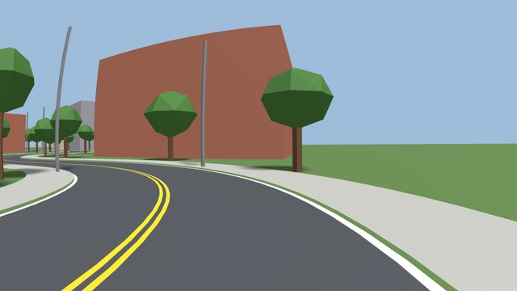</td><td>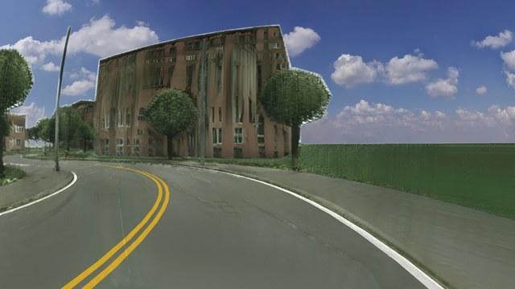</td><td align="center"><br><b></b></td></tr>
<tr><td>고속 S곡선<br>(골든 67.4 km/h)</td><td>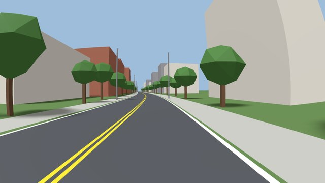</td><td>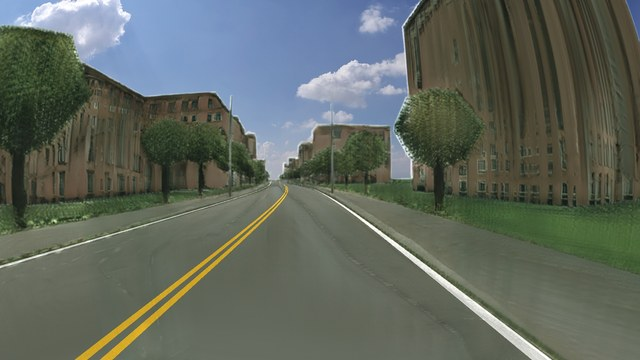</td><td align="center"><br><b></b></td></tr>
<tr><td>실제 클립<br>(골든 54.0 km/h)</td><td>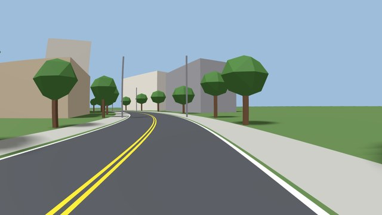</td><td>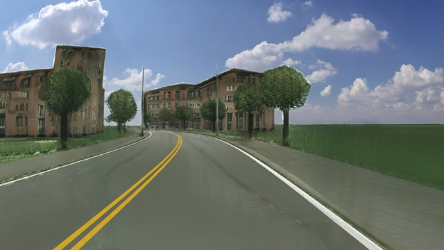</td><td align="center"><br><b></b></td></tr>
</table>

- 실사 변환은 질감·하늘·도로 색을 실제처럼 바꾸지만, 건물이 휘고 나무가 번지는 생성 결함이 함께 생김

### 2.2 open-loop 

| 조건·경로 | 계획 수 | 3 s 횡 이탈 Genesis / s2r (m) | ADE(Average Displacement Error, 평균 위치 오차) Genesis / s2r (m) |
|---|---|---|---|
| A S자 | 37 | 1.76 / **1.68** | **3.13** / 3.72 | 
| A 고속 S곡선 | 65 | **0.29** / 0.35 | **2.29** / 2.92 |
| A 실제 클립 | 64 | **1.04** / 1.20 | **2.07** / 2.57 | 
| B S자 | 37 | **1.54** / 1.58 | **3.07** / 4.34 | 
| B 실제 클립 | 64 | **0.94** / 1.23 | **2.43** / 3.59 |

- **ADE 는 5개 모두 s2r 이 나쁨**(+0.50~1.27 m), 3 s 횡 이탈은 4/5 에서 s2r 이 나쁨(+0.04~0.29 m, A S자만 0.08 m 작음)   
``` -> 실사 변환 자체의 퀼리티가 좋지 않아 나타나는 문제로 판단됨. 그래서 실제 클립으로 제공되는 이미지를 genesis 렌더로 변환 후 다시 실사 변환하여 실사 변환이 문제인지 확인 중. ```

open-loop 영상 (각 영상 왼쪽 Genesis 입력, 오른쪽 s2r 입력)

<table>
<tr><td align="center"><a href="https://github.com/user-attachments/assets/f019aa3b-3491-4e82-baa2-aac1975f9247">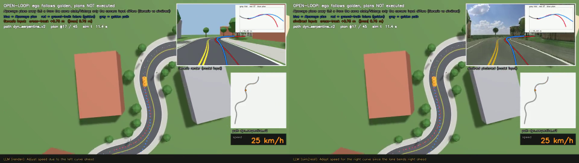</a><br>A 빈 도로 · S자</td><td align="center"><a href="https://github.com/user-attachments/assets/49a73250-97d5-45ff-bef4-f58f93031c0f">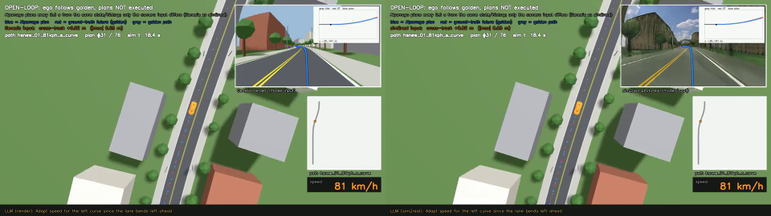</a><br>A 빈 도로 · 고속 S곡선</td></tr>
<tr><td align="center"><a href="https://github.com/user-attachments/assets/a8ea34ee-8a30-4430-bd01-2c2e055bff5e">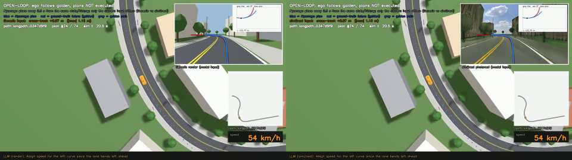</a><br>A 빈 도로 · 실제 클립</td><td align="center"><a href="https://github.com/user-attachments/assets/1ef6eed2-5afb-4f54-b7e0-272c3909b7d7"></a><br>B 앞차 · S자</td></tr>
<tr><td align="center"><a href="https://github.com/user-attachments/assets/6a09494a-8e6b-4a4c-ae55-443b225a9c50">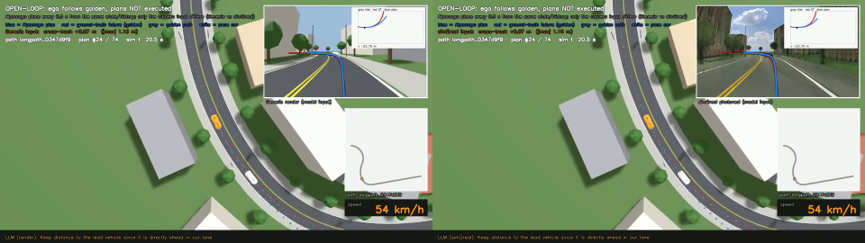</a><br>B 앞차 · 실제 클립</td></tr>
</table>

### 2.3 closed-loop

```ADE 대신 cte(경로에서 옆으로 벗어난 거리)```: closed-loop는 자차가 골든과 다른 위치·속도에서 계획하므로 같은 시각 정답 비교가 성립하지 않음 -> 경로에서 옆으로 벗어난 거리로 비교

| 조건·경로 | 입력 | 재출발 | cte 평균 / 최대 (m) | 차선 이탈 % (차체 가장자리가 차선을 넘음, cte > 0.69 m) |
|---|---|---|---|---|
| A S자 | Genesis | 2 | 4.14 / 11.41 | **79.7** |
| | s2r | 2 | **3.76 / 13.83** | 84.8 |
| A 고속 S곡선 | Genesis | 1 | **0.41 / 0.84** | 18.7 |
| | s2r | 1 | 0.49 / 0.88 | **15.0** |
| A 실제 클립 | Genesis | 1 | **1.19 / 3.80** | 56.0 |
| | s2r | 1 | 1.51 / 5.59 | **48.4** |
| B S자 | Genesis | 2 | 2.38 / 5.56 | 76.3 |
| | s2r | 3 | **2.22 / 5.80** | **66.7** |
| B 실제 클립 | Genesis | 1 | **0.87 / 2.76** | **35.8** |
| | s2r | 2 | 1.56 / 5.03 | 49.6 |

- **cte 평균 기준 s2r 나쁨 3 / 좋음 2**, 차선 이탈 기준으로는 반대로 좋음 3 / 나쁨 2 -> closed-loop 에서는 입력 렌더에 따른 일관된 차이 없음
- **실제 클립 도로는 2개 모두 cte 기준 s2r 나쁨**(+0.32, +0.69 m)
- S자는 두 입력 모두 Alpamayo 계획 자체가 84~86 % 차로 밖을 향함
- 두 입력 모두 앞이 비어도 이유 없이 감속·정지: 입력 렌더와 무관한 closed-loop에서 Alpamayo 자체의 문제 (Park & Shim [1], VLADriveBench [2])
- open-loop 은 실사 변환 쪽이 나쁨 -> 2.2절에서의 언급처럼 실험 진행 중.

<table>
<tr><td align="center"><a href="https://github.com/user-attachments/assets/19e6951a-885f-4b6d-b751-b904f8fd0d47">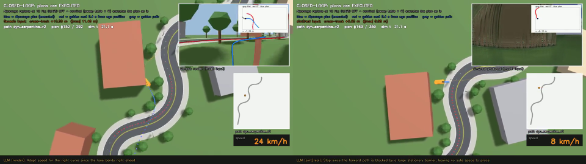</a><br>A 빈 도로 · S자</td><td align="center"><a href="https://github.com/user-attachments/assets/5461a4ad-c083-4fac-82be-0c4d709e0309">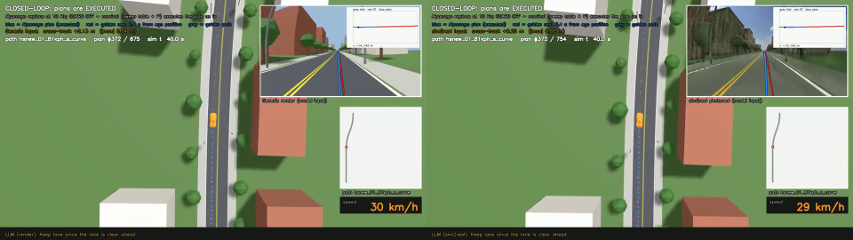</a><br>A 빈 도로 · 고속 S곡선</td></tr>
<tr><td align="center"><a href="https://github.com/user-attachments/assets/485a7c15-d743-4841-b933-34e283204100">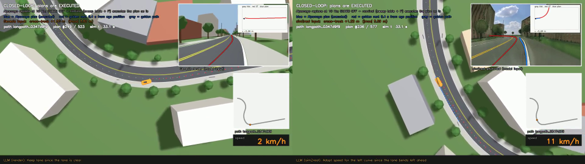</a><br>A 빈 도로 · 실제 클립</td><td align="center"><a href="https://github.com/user-attachments/assets/54237d83-71e3-4b3a-9915-4c397461f6f6">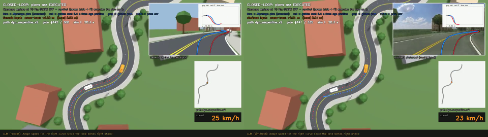</a><br>B 앞차 · S자</td></tr>
<tr><td align="center"><a href="https://github.com/user-attachments/assets/417dde05-6993-4418-85bc-77d5ca2e9785">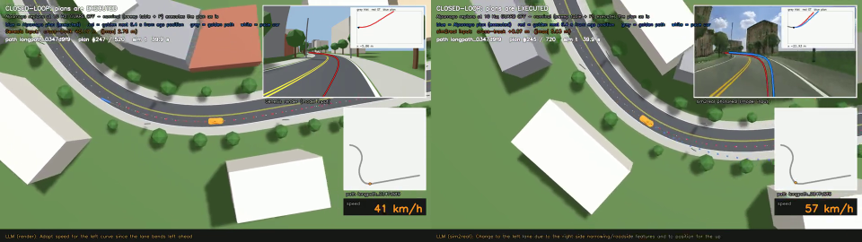</a><br>B 앞차 · 실제 클립</td></tr>
</table>

---

## 3. 실제 클립 3D 재현 — 진짜 영상 vs Genesis 재현 (open-loop)

### 3.1 재현 방법

| 요소 | 만드는 법 |
|---|---|
| 도로 폭·높이 | 라이다 점에 의미 분할(Mask2Former, Mapillary) 라벨을 붙여 경로 기준 좌표로 도로 폭 추정, 높이는 라이다 노면 점 |
| 차선 위치·색 | 위치 = 라이다 반사 강도 상위 3 % 점(도색), 색 = 분할 라벨 |
| 나무·길가 풀 | 수관 0.5 m 칸, 낮은 풀(0.2~1.5 m)은 실제 색을 칠한 둔덕 |
| 카메라 | 데이터셋 리그 그대로(f-theta, 장착 위치·자세), 자차 3D 회전 반영 |
| 보닛 | 실제 영상의 보닛 픽셀을 덮음(전방 캠 하단 17.8 %). AlpaSim 과 같은 방식(차량이 달라도 학습 데이터 리그의 보닛 마스크 사용, 설정 `ego_mask_rig_config_id: hyperion_8_1`) |
| 다른 차 | 클립의 물체 트랙을 시각대로 배치 |

- 재현 정확도(진짜 영상 분할과 재현 렌더 분할의 픽셀 일치): 전체 0.82~0.85

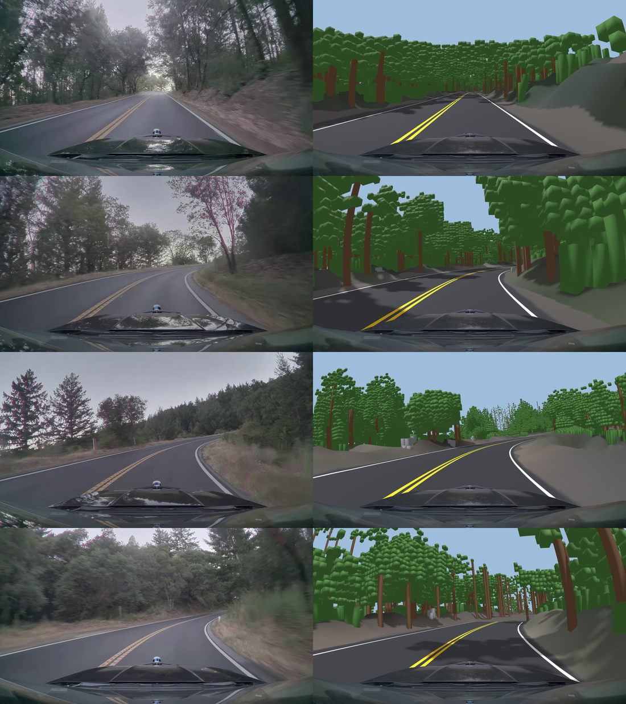

### open-loop 영상
[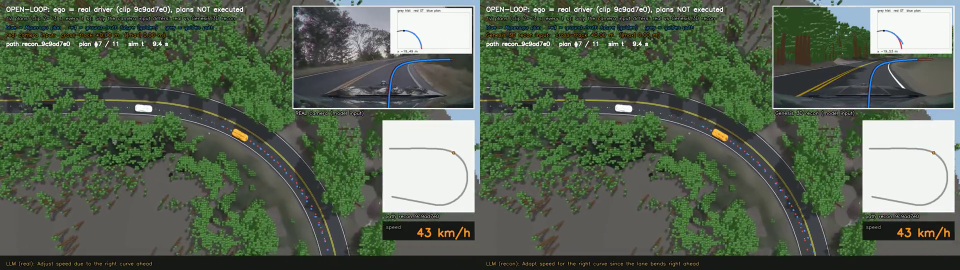](https://github.com/user-attachments/assets/6d3ef87f-7ef4-44ae-9509-db253f66c4b2)

### 3.2 open-loop 결과

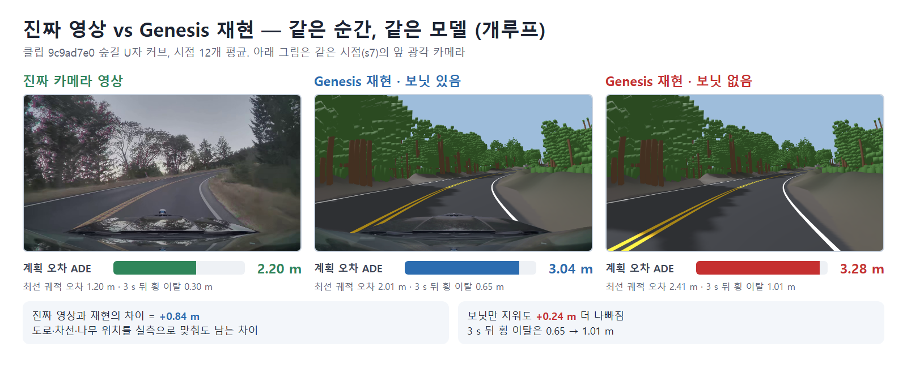

| 입력 | ADE(Average Displacement Error, 평균 위치 오차) m | 
|---|---|
| **진짜 영상** | **2.20** |
| Genesis 재현 · 보닛 있음 | 3.04 |
| Genesis 재현 · 보닛 없음 | 3.28 |

- 진짜 영상과 재현의 차 **0.84 m**: 도로·차선·나무 위치를 실측으로 맞춰도 남는 렌더 차이
- 보닛을 지우면 ADE +0.24 m, 3 s 횡 이탈 0.65 → 1.01 m -> 학습 데이터 차량의 보닛도 입력의 일부
- 남은 오차는 시점 s6~s9(오른쪽 커브 후반)에 몰림: 재현 입력에서 커브를 덜 꺾음

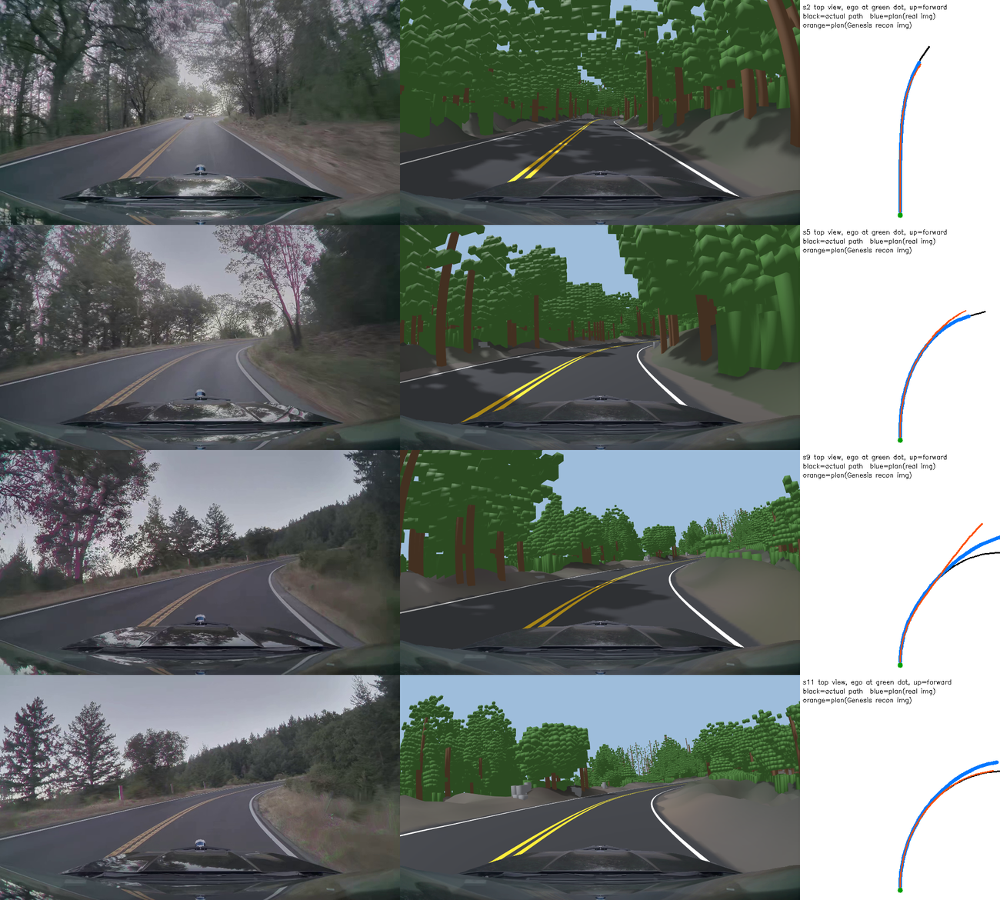

| 오른쪽 선 색 | 뜻 |
|---|---|
| 검정 | 실제 운전자가 간 경로 (정답) |
| 파랑 | 진짜 영상을 넣었을 때 Alpamayo 계획 |
| 주황 | Genesis 재현 렌더를 넣었을 때 Alpamayo 계획 |


## 4. 재현 장면 closed-loop 

| 경로 | 입력 | 재출발 | cte 평균 / 최대 (m) | 차선 이탈 % (차체 가장자리가 차선을 넘음, cte > 0.69 m) |
|---|---|---|---|---|
| 실제 클립 u자 | Genesis 재현 | 1 | 0.57 / 1.71 | 39.8 |

- U자 커브 저속 구간(19~27 s)에서 Alpamayo 계획이 차로 중심에서 바깥(왼쪽)으로 0.6 → 1.2 m 벗어남: cte 최대 1.71 m, 차선 이탈 39.8 %

- 멈추기 직전 Alpamayo 는 앞이 비었는데도 "오른쪽 커브라 감속"(Adapt speed for the right curve)이라는 판단을 반복하며 계획 속도를 0 까지 낮춤 -> 2.3 절과 같은 Alpamayo 자체의 문제 (Park & Shim [1], VLADriveBench [2])

[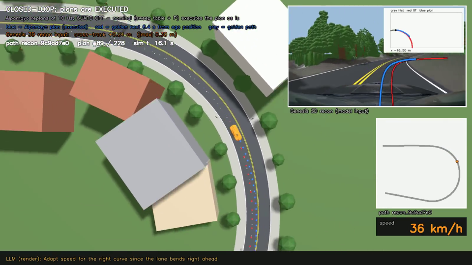](https://github.com/user-attachments/assets/8e4cd265-5ab8-4e9d-ab79-a26db3bd31d3)

## 5. TODO

- 실제 클립으로 제공되는 이미지를 genesis 렌더로 변환 후 다시 실사 변환하여 실사 변환이 문제인지 확인 중


## 참고 문헌

1. Park & Shim, *Grounding Driving VLA via Inverse Kinematics*, arXiv 2605.21061 (2026-05). https://arxiv.org/abs/2605.21061
2. Nguyen et al., *VLADriveBench: Evaluating CoT-Action Relationship in VLA for Autonomous Driving*, arXiv 2606.12706 (2026-06). https://arxiv.org/abs/2606.12706

