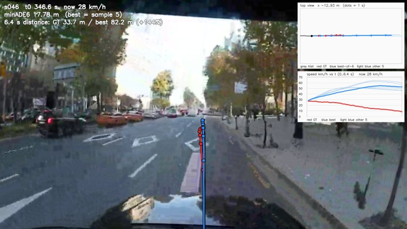
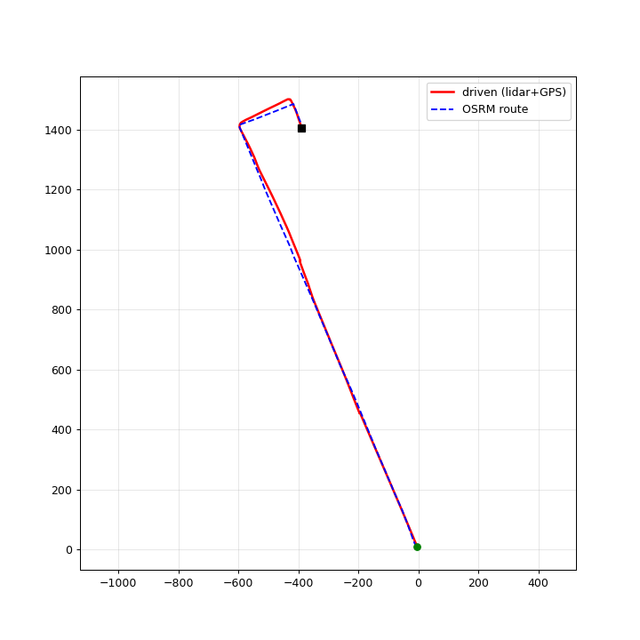
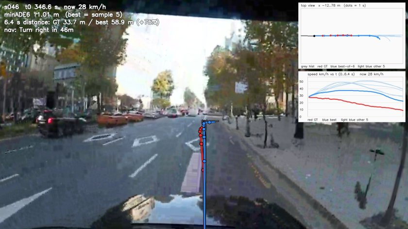
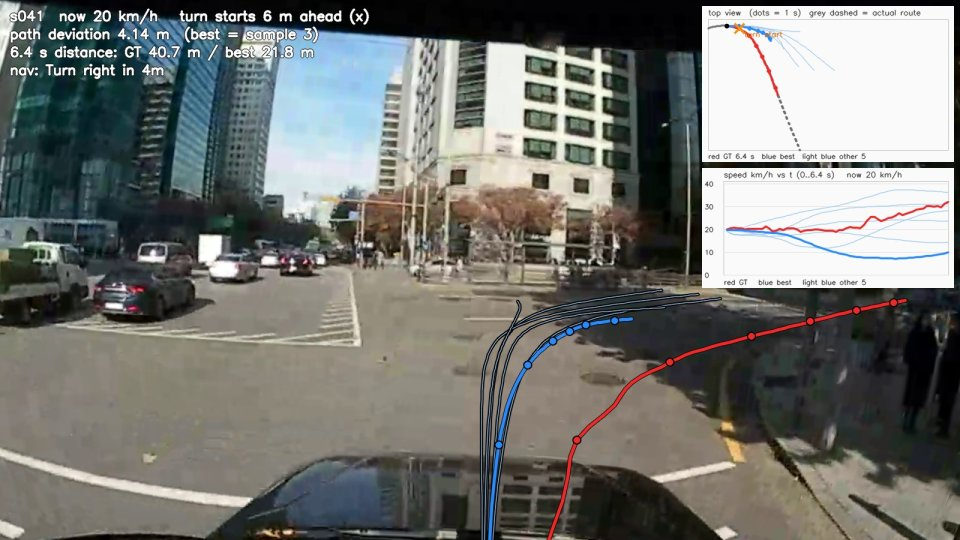
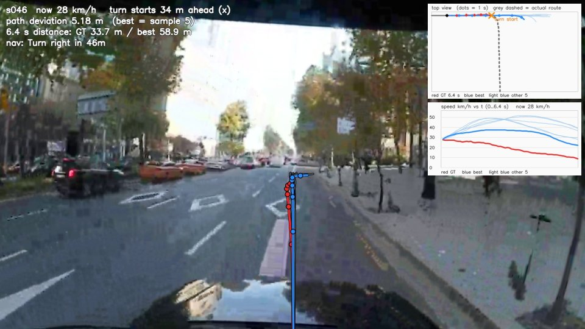
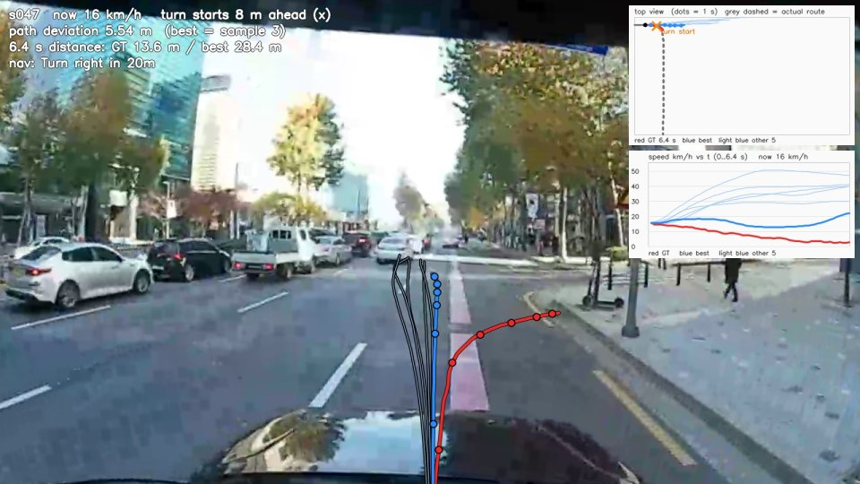
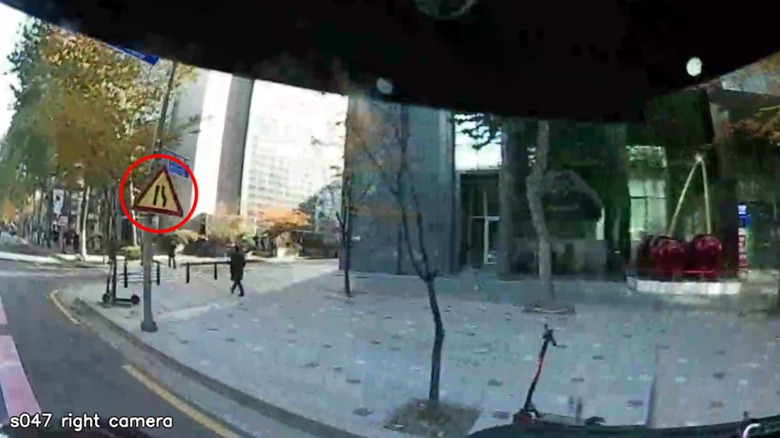

# 실차 데이터(서울 도심) Alpamayo open-loop

## 요약

**지난 지시**
- 실차 데이터(ADI, 서울 강남 도심 1.85 km)를 Alpamayo 1.5 에 넣어 open-loop 평가 (1절)
- 내비 문장은 장면마다 정답에서 뽑지 말고 **목적지 설정 → 내비 경로 기준**으로 생성, 안 따르면 가드가 경로에 맞게 잡음 (3절)
- 속도 오차는 경로의 제한속도를 지키게 하면 해결 -> **경로를 잘 따라가는지**로 평가 (1절)

**진행 상황**
- [완료] 내비 없음 → 목적지 경로 내비 (2~3절)
- [진행 중] 가드가 내비 경로로 잡아주기 (TODO)

**결과**
- 오차 4.45 m 중 경로에서 벗어난 몫은 0.61 m -> 나머지는 속도(얼마나 가느냐) 차이
- 회전 구간 경로 이탈: 내비 없음 1.53 m → 목적지 경로 내비 **1.27 m**

---

## 1. 개요

| 항목 |  |
|---|---|
| 데이터 | ADI_20191127 (서울 삼성로 → 테헤란로 → 테헤란로86길, 1,850 m, 우회전 2회) |
| 센서 | 360 카메라 → Alpamayo 입력 3캠(왼쪽·앞·오른쪽 광각)으로 변환 / VLP-16 라이다 주행거리계로 정답 궤적 0.1초 단위로 생성 |
| 평가 시점 | 54개: 주행 420 s 동안 4 s 마다, 정차 중(2 m/s 미만) 시점은 제외 |
| 예측 | 시점마다 Alpamayo 가 앞으로 6.4 s 동안 갈 경로를 6개 예측 |
| 모델 | Alpamayo 1.5 10B, 4bit 양자화(RTX 5070 Ti 16 GB) |

### 1.1 사용 지표

| | minADE6 (NVIDIA 공식 지표) | **경로 이탈** |
|---|---|---|
| 비교 대상 | 예측의 t초 위치 ↔ 정답의 같은 t초 위치 | 예측의 각 점 ↔ 정답 경로 위 가장 가까운 점 |
| 무엇을 봄 | 경로 모양 + 속도 | 경로 모양만 |
| 쓰는 값 | 시점마다 예측 경로 6개 중 오차가 가장 작은 1개 | 같음 |

- `ADE` = Average Displacement Error (예측·정답 위치 거리 평균)


### 1.2 경로 이탈 지표 추가 이유

``` 속도는 목적지 경로의 구간 제한속도로 통제 -> Alpamayo 는 경로 모양만 맞으면 됨. ```

---

## 2. 결과 1 — 내비 없음

| minADE6 (m) | 경로 이탈 (m) |
|---|---|
| 4.445 | 0.607 |

- **minADE6 4.45 m -> 경로 이탈 0.61 m**   
```-> 대부분은 속도 차이(54시점 중 36~37개)```

### NVIDIA 공식 수치와 비교

| 모델 · 데이터 | 평가 수 | minADE6@6.4s (m) |
|---|---|---|
| Alpamayo 1.5 10B, PhysicalAI-AV 어려운 장면 | 1,434 | 0.916 |
| Alpamayo 2 Super, PhysicalAI-AV 어려운 장면 | 1,434 | 0.911 |
| Alpamayo 1.5 4bit, PhysicalAI-AV 실제 클립 1개 (10.12 보고서 실제 클립 경로) | 11 | 1.85 |    
| **Alpamayo 1.5 4bit, ADI 서울 도심 (우리)** | 54 | **4.45** |

- 어려운 장면 = 복잡한 교차로·끼어들기·보행자 상호작용 등 안전에 중요한 드문 장면 위주 

``` -> Alpamayo 는 카메라 4개(광각 앞·왼쪽·오른쪽 + 망원 앞)를 입력으로 받는데 우리는 그 중 망원을 쓰지 않고 광각 3개를 360 영상을 잘라 만들었고, 학습 데이터(미국)에 없는 서울 도심 주행이라는 점을 고려해야 함```

[](https://github.com/user-attachments/assets/74bfaba9-193c-4079-8cee-5512e5ce8c2d)

```빨강 = 정답, 굵은 파랑 = 6개 중 최선, 옅은 파랑 = 나머지 5개, 점 = 1 s 간격. 오른쪽 위 = 위에서 본 경로, 그 아래 = 속도(km/h)```

### 남은 문제 = 회전 판단

| 장면 | 최선 예측 | 경로 이탈 (m) | 
|---|---|---|
| 첫 우회전 6 m 전 (s041) | 직진 후 정지 | 4.89 | 
| 두 번째 우회전 34 m 전 (s046) | 회전 지점을 지나 82 m 직진 | 11.08 | 
| 두 번째 우회전 8 m 전 (s047) | 직진 | 10.93 |

| 첫 우회전 6 m 전 | 두 번째 우회전 34 m 전 | 두 번째 우회전 8 m 전 |
|---|---|---|
|  |  |  |

```시드 42. 굵은 파랑 = 경로 이탈 최선, 오른쪽 위 회색 점선 = 실제 주행 경로(6.4 s 이후 포함), × = 회전 시작 지점(실제 경로 방향이 15° 넘게 바뀌는 곳)```


```-> 갈 길을 모르니 회전해야 할 곳에서 회전을 못 함 -> 내비 입력 필요```

---

## 3. 결과 2 — 목적지 경로 내비

- Alpamayo 1.5 내비 입력: `"Turn right in 46m"` 형식 (다음 회전 + 거리), 공식 예제와 같은 형식
- 출발·도착 좌표만 넣어 OSM 지도에서 경로 생성(OSRM) → 시점마다 내 위치에서 다음 회전까지 남은 거리로 안내 문장 생성

```OSM(OpenStreetMap) = 누구나 편집하는 공개 지도 (도로 연결·일방통행·제한속도 등 포함)```  
```OSRM(Open Source Routing Machine) = OSM 지도 위에서 출발지 → 목적지 최단 경로와 회전 안내를 계산하는 공개 길 찾기 엔진 -> 내비 앱이 목적지를 찍으면 경로를 만드는 방식과 같음```




| 시점 | 내비 문장 | 실제 회전까지 (m) |
|---|---|---|
| s040 | Turn right in 28m | 29 |
| s041 | Turn right in 4m | 5 |
| s045 | Turn right in 79m | 70 |
| s046 | Turn right in 46m | 37 |
| s047 | Turn right in 20m | 12 |


[](https://github.com/user-attachments/assets/6eae48fb-655e-4159-a1e2-ab481ca1e680)

| 구성 | minADE6 (m) | 경로 이탈 (m) |
|---|---|---|
| 내비 없음 | 4.445 | 0.607 |
| 목적지 경로 내비 | 4.469 | **0.534** |

- minADE6 는 변화 없음(+0.024 m), 경로 이탈 −0.07 m
- 회전 구간(회전 200 m 안 16시점) 경로 이탈 1.525 m → **1.274 m** (−16 %)

### 2절 문제 장면 해결 여부

| 첫 우회전 6 m 전 | 두 번째 우회전 34 m 전 | 두 번째 우회전 8 m 전 |
|---|---|---|
|  |  |  |

| 장면 | 내비 문장 | 최선 예측 (내비 없음 → 목적지 경로 내비) | 경로 이탈 (m) | 해결 |
|---|---|---|---|---|
| 첫 우회전 6 m 전 (s041) | Turn right in 4m | 직진 후 정지 → **우회전** (회전 시작 5 m 늦음, 실제보다 크게 돎) | 4.89 → **4.14** | △ |
| 두 번째 우회전 34 m 전 (s046) | Turn right in 46m | 회전 지점을 지나 82 m 직진 → **우회전** (회전 시작 20 m 늦음) | 11.08 → **5.18** | △ |
| 두 번째 우회전 8 m 전 (s047) | Turn right in 20m | 직진 → 직진 | 10.93 → 5.54 | X |

- 첫 우회전(s041): 실제 차는 회전 후 2차로로, Alpamayo 는 더 크게 돌아 1차로로 진입   
-> 도착 차로만 다르고 주행으로는 허용 가능한 회전

- 두 번째 우회전 8 m 전(s047): 내비 문장이 실제 회전까지의 거리와 달라서(8 m <-> 20 m) 해결되지 않았다고 판단

- But, 실제 거리 그대로 "Turn right in 8m"를 넣어도 우회전 0/18.   
-> CoT(판단 문장) 18개 중 15개가 "오른쪽 차로가 끝나 왼쪽으로 합류" (오른쪽 카메라에 '도로 폭 좁아짐' 경고 표지가 보임) -> 표지에 맞춰 왼쪽 합류를 택하고 바로 앞 우회전은 무시 



```s047 오른쪽 카메라 (Alpamayo 입력 3캠 중 하나), 빨간 원 = '도로 폭 좁아짐' 경고 표지```

- 내비로 회전 방향은 일부 잡지만 회전 위치·크기는 부정확

```-> Alpamayo 계획이 목적지 경로와 회전/직진 방향이 다르면 경로 쪽으로 바로잡는 가드 필요 (작은 차로 차이는 허용, 주변 차량·보행자 확인은 기존 가드 규칙 유지)```

---

## 4. TODO

- 가드: 목적지 경로를 기준선으로, Alpamayo 계획과 회전/직진 방향이 다르면 경로 쪽으로 바로잡음 (s047 처럼 내비가 있어도 회전 직전에 직진하는 경우). 작은 차로 차이(s041)는 허용, 주변 차량·보행자 확인은 기존 가드 규칙 유지

