# 실차 데이터(서울 도심) Alpamayo open-loop 판단 CoT 정리

## 1. 개요

| 항목 |  |
|---|---|
| 데이터 | ADI_20191127 (서울 삼성로 → 테헤란로 → 테헤란로86길, 1,850 m, 우회전 2회) |
| 결과 | 10.21 보고서 3절 목적지 경로 내비 (`pred_rco`), 시드 42 |
| 모델 | Alpamayo 1.5 10B, 4bit 양자화 |
| 입력 | 왼쪽·앞·오른쪽 광각 3캠 (시점당 4프레임, 0.3 s), 이력 궤적, 내비 문장 (OSM 경로 기준 다음 회전까지 거리). 시점마다 따로 추론하며 이전 시점의 CoT 는 입력에 없음 |
| 본문 표시 | 13시점(교차로, 회전, 옆 차, 정차 물체, 보행자): 최적 샘플 + 다른 예측 2~4개 |

- `CoT` = Chain of Thought (행동과 그 이유를 쓴 문장)

---

## 2. 경로 위 판단

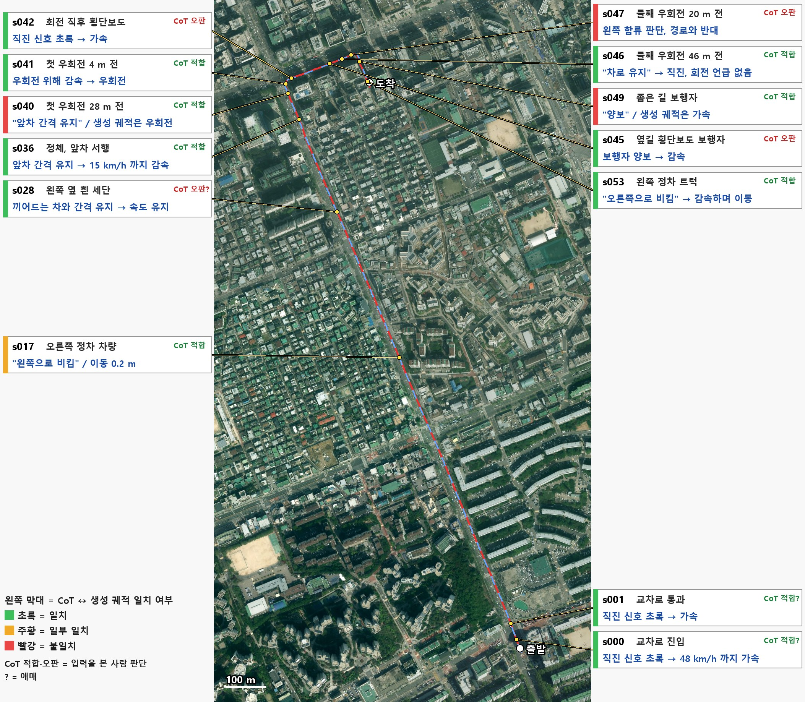

```빨강 선 = 실제 주행, 파랑 점선 = 목적지 설정으로 만든 내비 경로, 노랑 점 = 평가 시점```

---

## 3. 시점별 결과

### 3.1 첫 교차로

#### s000 — 교차로 진입

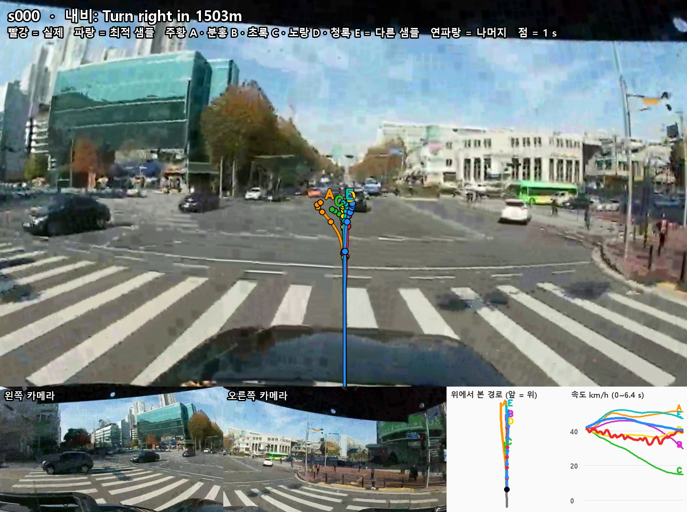

**최적 샘플 (파랑)**
- **CoT**: `Accelerate to proceed through the intersection since the straight traffic light is green`
- **번역**: 직진 신호가 초록이므로 가속해 교차로 통과
- **CoT 적합성: 적합(애매)**
  - 직진 신호에 알맞게 통과. 다만 앞 신호 색이 명확하진 않음.
- **생성 궤적: 일치**
  - 48 km/h 까지 가속 후 42 km/h 로 통과

**다른 예측**

| 예측 | CoT | CoT 적합성 | 생성 궤적 |
|---|---|---|---|
| A (주황) | 최적 샘플과 같은 문장 | **적합(애매)**<br>최적 샘플과 같음 | **일치**<br>51 km/h 까지 가속. 다만 문장에 없는 왼쪽 이동 5.9 m |
| B (분홍) | 최적 샘플과 같은 문장 | **적합(애매)**<br>최적 샘플과 같음 | **불일치**<br>"가속"인데 30 km/h 까지 감속 |
| C (초록) | `Slow down to create a gap for merging into the right lane after clearing the intersection, since lane changes inside the junction are unsafe and there is moving traffic in our right lane that we must merge into.` (교차로 안 차로 변경은 위험하고 오른쪽 차로에 움직이는 차들이 있어, 교차로를 지난 뒤 오른쪽 차로로 합류할 간격을 만들려고 감속) | **오판**<br>합류할 오른쪽 차로는 교차로 건너편이고 그 차로의 차(파란 버스)도 건너편에 있음. 내비 우회전도 1,503 m 앞이라 지금 감속해 합류를 준비할 이유가 없음 | **일치**<br>15 km/h 까지 감속.  |
| D (노랑) | `Stop for the red traffic light ahead` (앞 빨간 신호에 정지) | **오판(애매)**<br>앞 신호 색이 안 보이는데 빨간불로 단정함. | **불일치**<br>최저 36 km/h, 정지 안 하고 통과 -> **CoT를 생성 궤적이 따르지 않음**.  |
| E (청록) | `Keep distance to the lead vehicle since it is directly ahead in our lane` (앞차와 간격 유지) | **오판**<br>교차로 진입인데 신호 판단이 없음 | **일치**<br>직진, 50 km/h 까지 가속. |

#### s001 — 교차로 통과

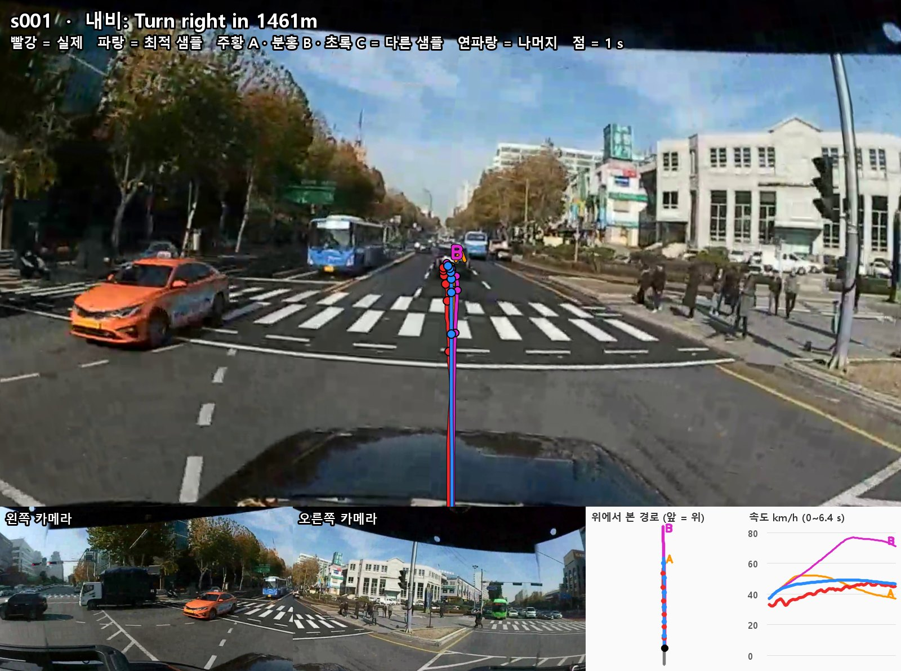

**최적 샘플 (파랑)**
- **CoT**: `Accelerate to proceed through the intersection since the straight traffic light is green`
- **번역**: 직진 신호가 초록이므로 가속해 교차로 통과
- **CoT 적합성: 적합(애매)**
  - 현재 장면에서는 신호 확인 불가. 다만, 이전 장면에서의 자차 이력을 반영하여 판단하였다면 적합.
- **생성 궤적: 일치**
  - 48 km/h 까지 가속, 직진. 

**다른 예측**

| 예측 | CoT | CoT 적합성 | 생성 궤적 |
|---|---|---|---|
| A (주황) | 최적 샘플과 같은 문장 | **적합(애매)**<br>최적 샘플과 같음 | **일치**<br>40 km/h 까지 가속 |
| B (분홍) | `Create a usable gap in the right lane because lane change is restricted in the intersection and a car is stopped behind in that lane` (교차로 안 차로 변경 제한, 오른쪽 차로 뒤에 정지 차가 있어 간격 확보) | **오판**<br>입력 3캠에 뒤쪽이 안 보이는데 뒤쪽 정지 차를 단정함. 내비 우회전도 1,461 m 앞이라 오른쪽 차로로 옮길 이유가 없음 | **일치**<br>차로 유지 기준. 다만 75 km/h 까지 가속 |

### 3.2 삼성로 직선 구간

#### s017 — 오른쪽 정차 차량

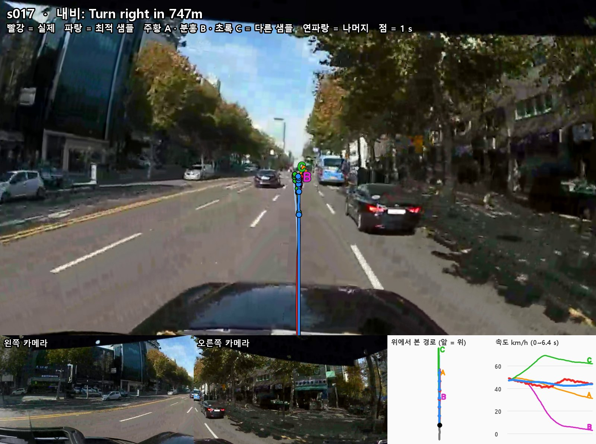

**최적 샘플 (파랑)**
- **CoT**: `Nudge left due to the stopped vehicle blocking the right side of our lane`
- **번역**: 정차 차량이 차로 오른쪽을 막고 있어 왼쪽으로 살짝 비킴
- **CoT 적합성: 적합**
  - 오른쪽에 버스가 정차해 있어 검은 세단이 끼어들 수 있기 때문에 옆 간격을 넓히는 판단 자체는 타당
- **생성 궤적: 일부**
  - 왼쪽 이동 0.2 m. 물체는 봤지만 비키는 동작은 작음

**다른 예측**

| 예측 | CoT | CoT 적합성 | 생성 궤적 |
|---|---|---|---|
| A (주황) | `Keep distance to the cut-in vehicle since it merges into our lane ahead` (끼어드는 차와 간격 유지) | **적합**<br>오른쪽 차선에 버스가 정차해 있어 오른쪽 검은 세단이 차선 변경할 것이라 판단 가능 | **일치**<br>31 km/h 까지 감속 |
| B (분홍) | `Keep distance to the lead vehicle since it is directly ahead in our lane` (앞차와 간격 유지) | **오판**<br>같은 차로에 차량이 멀리 있어 간격 유지의 이유로 약함 | **불일치**<br>3 km/h 까지 감속. 차량이 멀리 있어 급브레이크할 이유가 없음 |
| C (초록) | B 와 같은 문장 | **오판**<br>B 와 같음 | **불일치**<br>63 km/h 까지 가속, 왼쪽 1.5 m |

```-> B·C: 같은 CoT 인데 끝 속도 5 km/h vs 63 km/h```

#### s028 — 왼쪽 옆 흰 세단

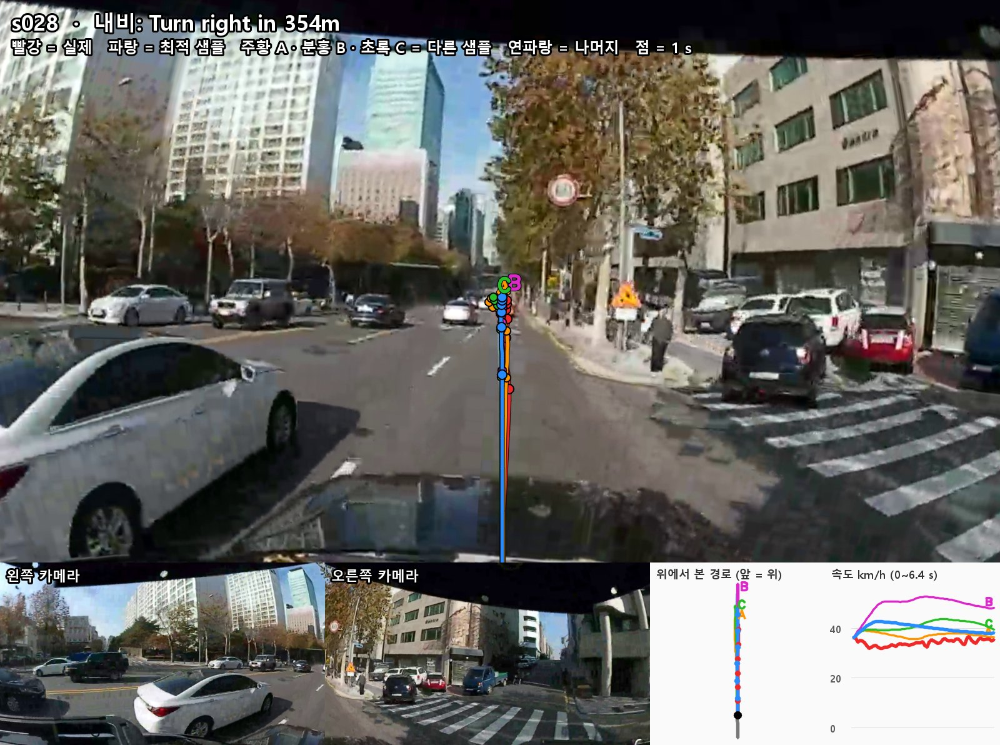

**최적 샘플 (파랑)**
- **CoT**: `Keep distance to the cut-in vehicle since it merges into our lane ahead`
- **번역**: 끼어드는 차가 앞에서 우리 차로로 들어오므로 간격 유지
- **CoT 적합성: 오판(애매)**
  - 흰 세단은 점선 왼쪽 옆 차로에 있고, 바로 옆에 있어 합류한다고 보기에 애매함. 
- **생성 궤적: 일치**
  - 38 km/h 유지, 차로 유지. 실제 차(32~37 km/h)와 비슷

**다른 예측**

| 예측 | CoT | CoT 적합성 | 생성 궤적 |
|---|---|---|---|
| A (주황) | `Slow down to create a gap for the white sedan merging from the left into our lane ahead, ensuring safe following distance as it moves into our path.` (왼쪽에서 앞으로 합류하는 흰색 세단에게 간격을 주려고 감속, 우리 경로로 들어오는 동안 안전거리 유지) | **오판(애매)**<br>최적 샘플과 같음 | **불일치**<br>속도 유지 -> **오판을 생성 궤적이 따르지 않음** |
| B (분홍) | 최적 샘플과 같은 문장 | **오판(애매)**<br>최적 샘플과 같음 | **불일치**<br>50 km/h 까지 가속 |
| C (초록) | `Create a usable gap for a left lane change because a car is alongside in the left lane blocking an immediate merge` (왼쪽 옆 차가 막아 왼쪽 차로 변경 간격 확보) | **오판(애매)**<br>왼쪽 옆 흰 세단은 맞음. 다만 왼쪽으로 차로를 바꿀 이유가 화면에 없고 내비는 354 m 앞 우회전 | **일치**<br>다만 왼쪽으로 1.3 m 이동 |

#### s036 — 정체 구간 앞차

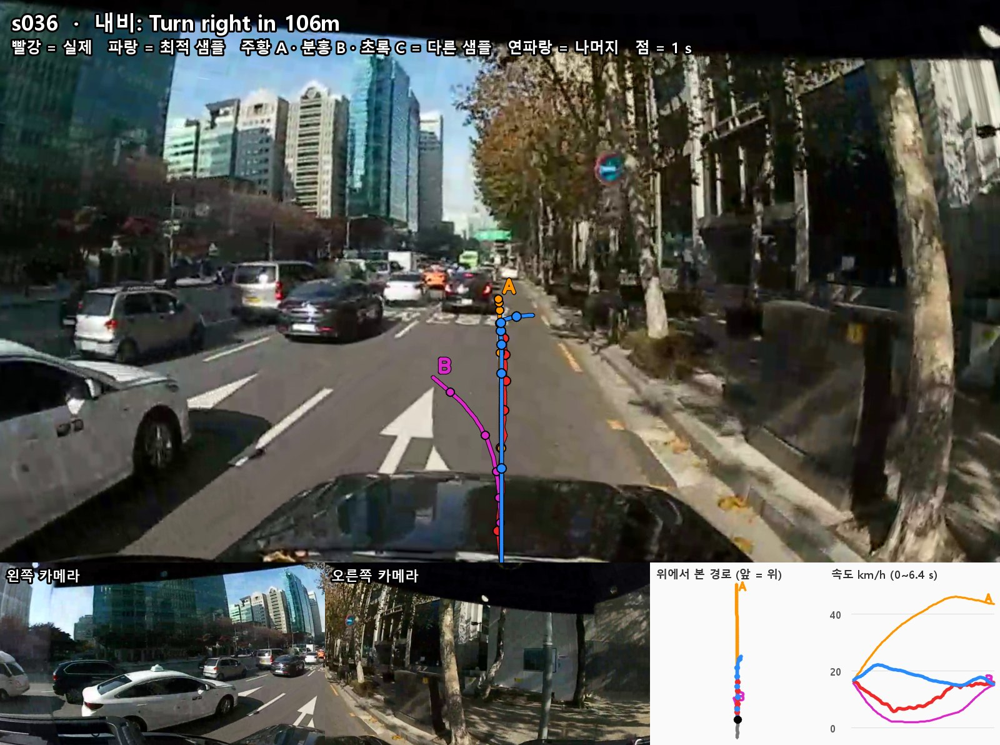

**최적 샘플 (파랑)**
- **CoT**: `Keep distance to the lead vehicle since it is moving slowly ahead`
- **번역**: 앞차가 천천히 가고 있으므로 간격 유지
- **CoT 적합성: 적합**
  - 정체 구간이고 같은 차로 앞차에 브레이크등이 켜져 있음
- **생성 궤적: 일치**
  - 15 km/h 까지 감속 후 직진 

**다른 예측**

| 예측 | CoT | CoT 적합성 | 생성 궤적 |
|---|---|---|---|
| A (주황) | 최적 샘플과 같은 문장 | **적합**<br>최적 샘플과 같음 | **불일치**<br>"간격 유지"인데 45 km/h 까지 가속 |
| B (분홍) | `Slow down to create a gap for merging left because our current right lane tapers into a curbside/parking area and vehicles alongside in our left lane block an immediate merge, with pedestrians walking along the right sidewalk making staying right unsafe.` (현재 오른쪽 차로가 갓길·주차 구역으로 좁아지고 왼쪽 차로 옆 차량이 즉시 합류를 막으며 오른쪽 보도에 보행자가 있어 오른쪽에 머물기 위험하므로, 왼쪽 합류 간격을 만들려고 감속) | **오판**<br>왼쪽 옆 차량은 맞음. 다만 화면에 차로가 줄어드는 표시가 없고 우리 차로 노면에 직진·우회전 화살표가 있으며, 오른쪽 보도에 보행자가 안 보임. 내비는 106 m 앞 우회전인데 왼쪽으로 합류하려 함 | **일치**<br>2 km/h 까지 감속 후 왼쪽으로 1.6 m 이동 -> **오판을 생성 궤적이 그대로 실행** |

### 3.3 첫 우회전

#### s040 — 우회전 28 m 전

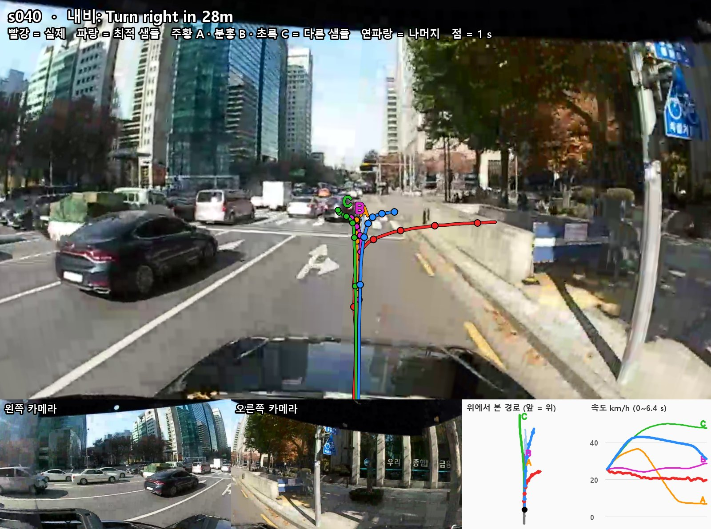

**최적 샘플 (파랑)**
- **CoT**: `Keep distance to the lead vehicle since it is slowing ahead`
- **번역**: 앞차가 감속하고 있으므로 간격 유지
- **CoT 적합성: 적합**
  - 앞차에 브레이크등이 켜져 있어 간격을 유지하기 위해 감속해야함
- **생성 궤적: 불일치**
  - 문장에 없는 우회전을 시작하고 감속해야 하지만 37 km/h 까지 가속 -> **내비는 생성 궤적에만 일부 반영, CoT에는 반영이 안됨**

**다른 예측**

| 예측 | CoT | CoT 적합성 | 생성 궤적 |
|---|---|---|---|
| A (주황) | `Yield to the cut-in vehicle from the left since it merges into our lane ahead` (왼쪽에서 끼어드는 차에 양보) | **오판(애매)**<br>왼쪽 차량은 실선 너머에 있음 | **일치**<br>7 km/h 까지 감속 |
| B (분홍) | `Keep distance to the lead vehicle since it is directly ahead in our lane` (앞차와 간격 유지) | **적합**<br>최적 샘플과 같음 | **일치**<br>직진해 CoT 와 일치. 다만, **내비 `Turn right in 28m` 미반영** |
| C (초록) | 최적 샘플과 같은 문장 | **적합**<br>최적 샘플과 같음 | **불일치**<br>48 km/h 까지 가속 |

#### s041 — 우회전 4 m 전

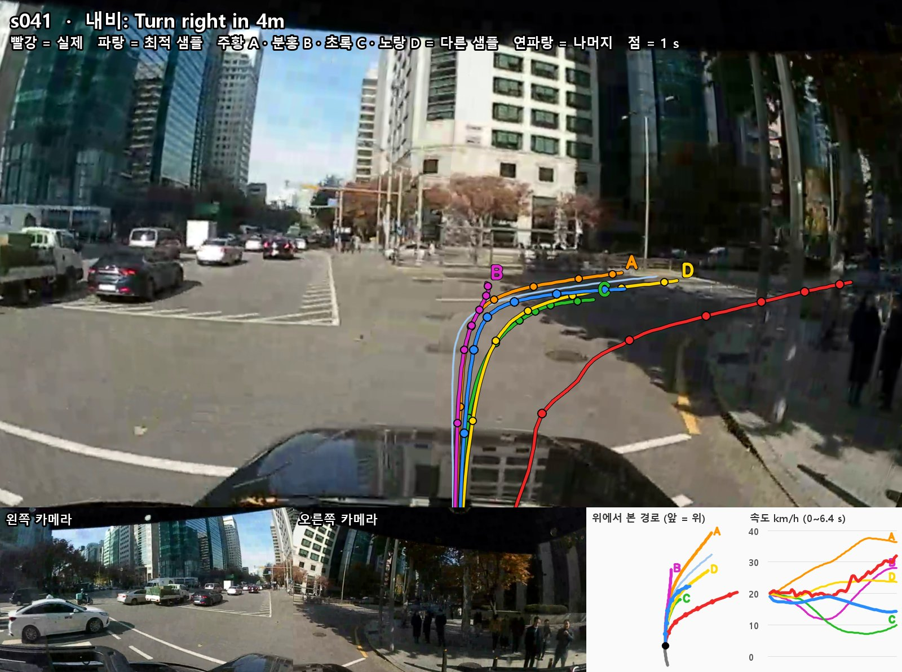

**최적 샘플 (파랑)**
- **CoT**: `Slow down to turn right at the intersection`
- **번역**: 교차로에서 우회전하려고 감속
- **CoT 적합성: 적합**
  - 우회전은 내비·화면과 맞음.
- **생성 궤적: 일치**
  - 14 km/h 까지 감속하며 우회전

**다른 예측**

| 예측 | CoT | CoT 적합성 | 생성 궤적 |
|---|---|---|---|
| A (주황) | `Turn right at the intersection since the right-turn traffic light is green` (우회전 신호 초록, 교차로에서 우회전) | **적합(애매)**<br>위 장면에서 우회전 신호가 잘 보이지 않음. 다만, 다음 장면에서 확인 가능.  | **일치**<br>오른쪽 20.0 m, 37 km/h 까지 가속. |
| B (분홍) | A 와 같은 문장 | **적합(애매)**<br>A 와 같음 | **불일치**<br>"우회전"인데 오른쪽 2.5 m, 사실상 직진 |
| C (초록) | `Keep distance to the cut-in vehicle since it merges into our lane ahead` (끼어드는 차와 간격 유지) | **오판**<br>꺾는 길에 들어오는 차가 없고 왼쪽 차들은 우리 경로 밖에 있음 | **일치**<br>7 km/h 까지 감속 |
| D (노랑) | `Slow down due to the upcoming right curve` (앞 우회전 곡선 때문에 감속) | **적합**<br>최적 샘플과 같음 | **일부**<br>우회전은 맞지만 감속은 1 km/h 수준 |

#### s042 — 회전 직후 횡단보도

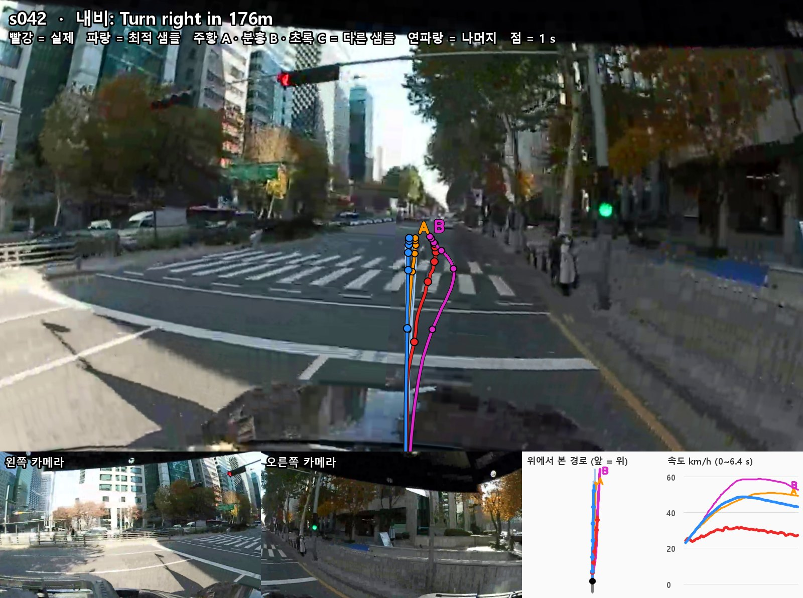

**최적 샘플 (파랑)**
- **CoT**: `Accelerate to proceed through the intersection since the straight traffic light turns green`
- **번역**: 직진 신호가 초록으로 바뀌므로 가속해 교차로 통과
- **CoT 적합성: 오판**
  - 우회전 신호가 초록이고, 횡단보도인데 가속한 것도 잘못 판단
- **생성 궤적: 일치**
  - 45 km/h 까지 가속하여 통과

**다른 예측**

| 예측 | CoT | CoT 적합성 | 생성 궤적 |
|---|---|---|---|
| A (주황) | 최적 샘플과 같은 문장 | **오판**<br>최적 샘플과 같음 | **일치**<br>50 km/h 까지 가속 |
| B (분홍) | 최적 샘플과 같은 문장 | **오판**<br>최적 샘플과 같음 | **일치**<br>56 km/h 까지 가속 |

### 3.4 테헤란로 ~ 둘째 우회전

#### s045 — 옆길 횡단보도 보행자

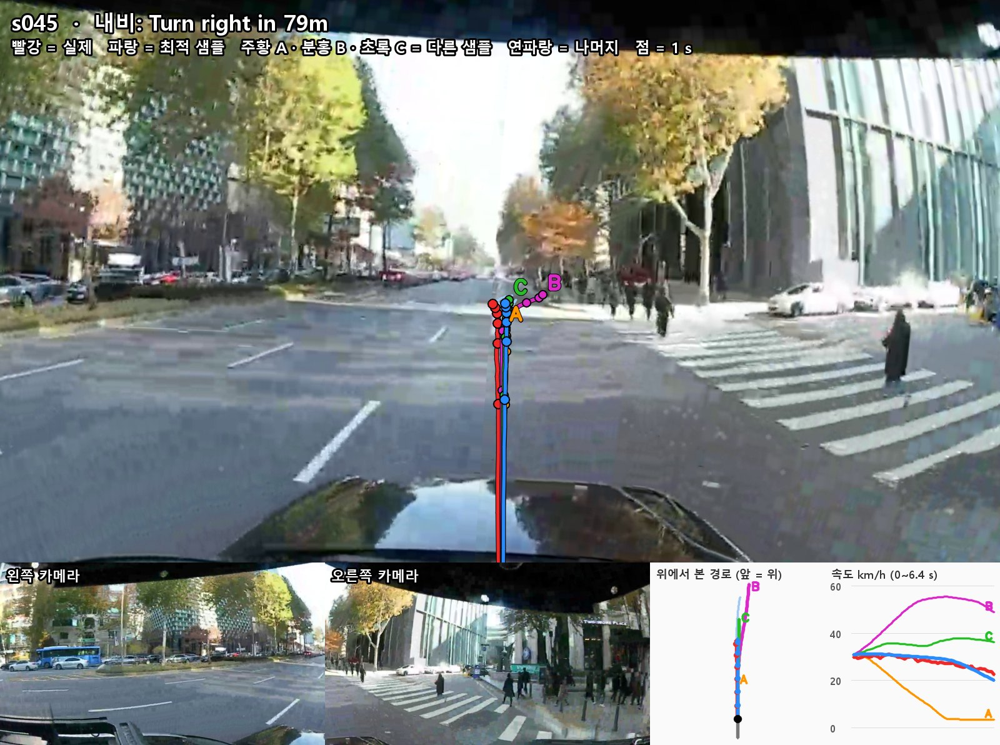

**최적 샘플 (파랑)**
- **CoT**: `Yield to the pedestrian since they are walking across our lane at the crosswalk ahead`
- **번역**: 앞 횡단보도에서 보행자가 우리 차로를 건너고 있으므로 양보
- **CoT 적합성: 오판**
  - 보행자와 횡단보도는 맞게 봤지만, 횡단보도가 옆길을 건너는 것이라 우리 차로를 건너는 사람은 없음. 보행자 옆을 지나며 속도를 줄이는 행동 자체는 타당
- **생성 궤적: 일치**
  - 뒤쪽에서 감속, 실제 차도 감속

**다른 예측**

| 예측 | CoT | CoT 적합성 | 생성 궤적 |
|---|---|---|---|
| A (주황) | `Stop to yield to the pedestrians in the crosswalk ahead since they are crossing our lane` (횡단 보행자에 양보해 정지) | **오판**<br>우리 차로를 건너는 보행자가 없어 정지할 이유가 없음 | **일치**<br>3 km/h 까지 감속 |
| B (분홍) | `Slow down due to pedestrians in the crosswalk ahead` (앞 횡단보도 보행자 때문에 감속) | **오판**<br>최적 샘플과 같음 | **불일치**<br>"감속"인데 53 km/h 까지 가속 |
| C (초록) | `Nudge left due to pedestrians walking across from the right` (오른쪽에서 건너는 보행자 때문에 왼쪽으로 비킴) | **오판**<br>오른쪽 보행자는 맞지만 우리 차로 쪽으로 건너지는 않음 | **불일치**<br>왼쪽이 아니라 오른쪽 1.0 m 감 |

```-> 이유는 모두 보행자로 같지만 생성 궤적은 정지부터 가속까지 갈림```

#### s046 — 우회전 46 m 전

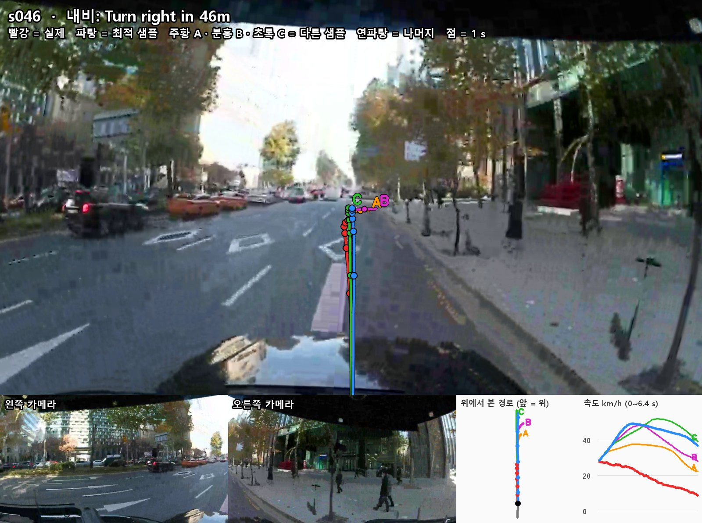

**최적 샘플 (파랑)**
- **CoT**: `Keep lane since the lane is clear ahead`
- **번역**: 앞 차로가 비어 있으므로 차로 유지
- **CoT 적합성: 적합**
  - 우리 차로 앞에 가까운 차가 없음. 다만 `Turn right in 46m` 언급은 없음
- **생성 궤적: 일치**
  - 직진해 CoT 와 일치. 다만 42 km/h 까지 가속해 실제 차가 감속하여 회전을 준비하지 않음

**다른 예측**

| 예측 | CoT | CoT 적합성 | 생성 궤적 |
|---|---|---|---|
| A (주황) | 최적 샘플과 같은 문장 | **적합**<br>최적 샘플과 같음 | **불일치**<br>"차로 유지"인데 끝에서 오른쪽으로 꺾음.  -> **내비는 생성 궤적에만 일부 반영, CoT 에 반영 x** |
| B (분홍) | 최적 샘플과 같은 문장 | **적합**<br>최적 샘플과 같음 | **불일치**<br>A와 마찬가지 |
| C (초록) | `Keep distance to the cut-in vehicle since it merges into our lane ahead` (끼어드는 차와 간격 유지) | **오판(애매)**<br>왼쪽 SUV는 옆 차로에 있고 끼어드는 모습은 안 보임 | **불일치**<br>46 km/h 까지 가속 |

#### s047 — 우회전 20 m 전

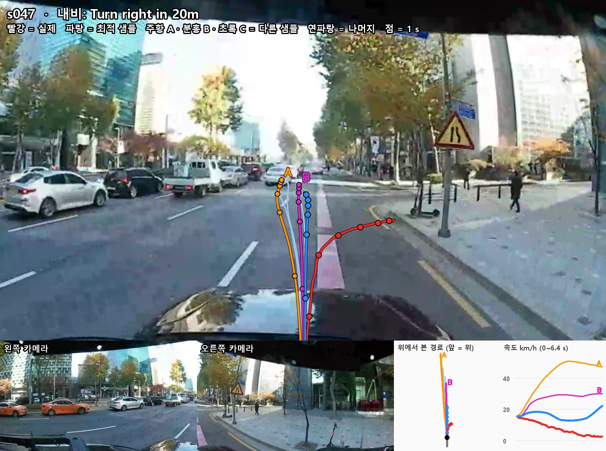

**최적 샘플 (파랑)**
- **CoT**: `Slow down to create a gap for merging left, since our current right lane tapers/ends ahead and cars are occupying the left lane beside us, preventing an immediate merge`
- **번역**: 현재 오른쪽 차로가 앞에서 좁아져 끝나고 왼쪽 차로에 차량이 있어 바로 합류할 수 없으므로, 왼쪽 합류 간격을 만들려고 감속
- **CoT 적합성: 오판**
  - '우측 차로 없어짐' 표지판과 왼쪽 차량은 화면과 맞음. 다만 내비가 20 m 앞 우회전이라 왼쪽 합류는 경로와 반대.
- **생성 궤적: 불일치**
  - 감속하지 않고, 속도 유지


**다른 예측**

| 예측 | CoT | CoT 적합성 | 생성 궤적 |
|---|---|---|---|
| A (주황) | `Wait for a gap because vehicles in the left lane are alongside blocking an immediate merge to the left` (왼쪽 옆 차들이 막아 합류 간격 대기) | **오판**<br>내비에 맞게 감속하면서 우회전해야함 | **불일치**<br>49 km/h 까지 가속 |
| B (분홍) | `Wait for a gap because a car is coming from behind in our left lane blocking an immediate merge to the left` (왼쪽 뒤에서 오는 차 때문에 합류 간격 대기) | **오판(애매)**<br>내비에 맞게 감속하면서 우회전해야함 | **불일치**<br> 29 km/h 까지 가속 |

### 3.5 테헤란로86길

#### s049 — 좁은 길 보행자

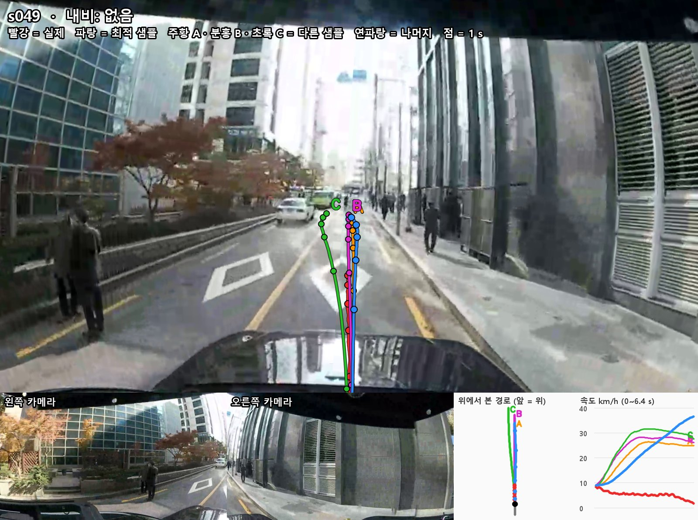

**최적 샘플 (파랑)**
- **CoT**: `Yield to the pedestrian since they are walking into our lane ahead`
- **번역**: 보행자가 앞에서 우리 차로로 들어오고 있으므로 양보
- **CoT 적합성: 적합**
  - 먼 앞쪽 우리 차로 위에 사람이 보임. 
- **생성 궤적: 불일치**
  - 33 km/h 까지 계속 가속 -> **CoT 는 양보인데 생성 궤적은 가속**.

**다른 예측**

| 예측 | CoT | CoT 적합성 | 생성 궤적 |
|---|---|---|---|
| A (주황) | `Slow down due to a speed bump ahead` (앞 과속방지턱 때문에 감속) | **오판**<br>앞 노면에 있는 것은 마름모 표시이고 과속방지턱은 안 보임 | **불일치**<br>25 km/h 까지 가속 |
| B (분홍) | `Keep distance to the lead vehicle since it is directly ahead in our lane` (앞차와 간격 유지) | **오판(애매)**<br>앞쪽 흰 차와 초록 버스는 노란 선 왼쪽에 있고 우리 차로 앞에 차는 없음 | **불일치**<br>28 km/h 까지 가속 |
| C (초록) | `Yield to the pedestrian since they are walking into our lane ahead` (차로로 들어오는 보행자에 양보) | **적합**<br>최적 샘플과 같음 | **불일치**<br>30 km/h 까지 가속|

#### s053 — 왼쪽 정차 트럭

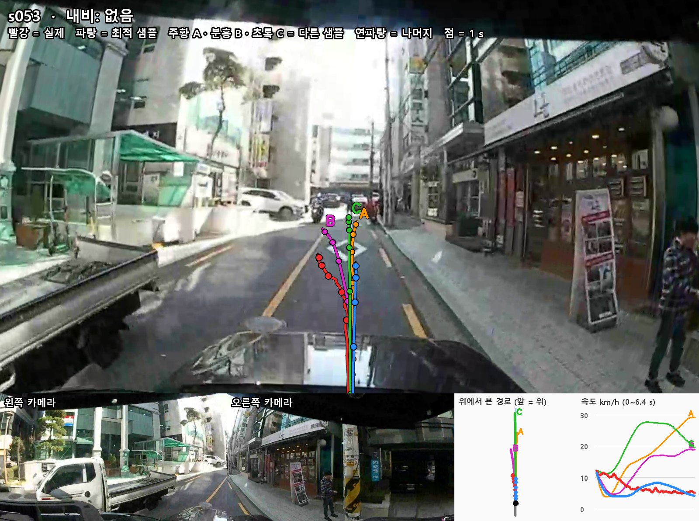

**최적 샘플 (파랑)**
- **CoT**: `Nudge to the right to clear the stopped truck blocking the left side of our lane`
- **번역**: 정차 트럭이 차로 왼쪽을 막고 있어 오른쪽으로 비킴
- **CoT 적합성: 적합**
- **생성 궤적: 일치**
  - 왼쪽 트럭에 부딪히지 않게 조심히 감속하며 이동

**다른 예측**

| 예측 | CoT | CoT 적합성 | 생성 궤적 |
|---|---|---|---|
| A (주황) | `Nudge right due to the stopped truck blocking the left side of our lane` (정차 트럭 때문에 오른쪽으로 비킴) | **적합**<br>최적 샘플과 같음 | **일치** |
| B (분홍) | `Nudge to the right to clear the stopped truck blocking the left side of our lane` (최적 샘플과 같은 문장) | **적합**<br>최적 샘플과 같음 | **불일치**<br>왼쪽으로 이동 |
| C (초록) | `Accelerate to clear the parked truck blocking the lane` (주차 트럭을 지나가려고 가속) | **오판**<br>앞에 오토바이와 사람이 있는 좁은 길에서 가속은 부적절 | **일치**<br>24 km/h 까지 가속 |

---

## 4. 정리

### 4.1 VLA 를 쓰는 이유

- ```생성 궤적과 함께 판단 근거(CoT)를 제시하여 주행 문제의 원인을 추적할 수 있음. 본 결과에서도 이를 통해 CoT 자체의 오판과 CoT ↔ 생성 궤적 간 불일치라는 두 가지 문제를 확인함.```

### 4.2 관련 논문 (CoT 자체 오판): [NeurIPS 2026 Workshop] TRUST

| 항목 |  |
|---|---|
| 학회 | **NeurIPS 2026 Workshop** (Physical Understanding for Decision-Making) 포스터 ([공식 페이지](https://neurips.cc/virtual/2026/159686)) |
| 제목 | Trustworthy and Safe Reasoning in End-to-End Autonomous Driving Foundation Models (긴 판: When Reasoning Helps Action: Monitoring and Steering Chain-of-Thought in Vision-Language-Action Policies, [arXiv 2610.00601](https://arxiv.org/abs/2610.00601)) |
| 소속 | Stanford University |
| 대상 | 운전: Alpamayo 1.5 10B (CoT 730개, AlpaSim 888 클립) / 로봇팔: DeepThinkVLA |

**핵심 질문:** 잘못된 CoT 를 찾아 고칠 수 있는가 -> 고치면 행동도 나아지는가

**방법:** 입력 화면과 생성 중인 CoT 앞부분으로 최종 CoT 가 맞을지 예측하는 별도 모델 학습 -> 틀릴 것 같으면 다음 단어를 바꿔 생성 (Alpamayo 가중치는 그대로)

| 실험 (Alpamayo 1.5) | 결과 |
|---|---|
| CoT 정답률 (VLM 심판이 입력 화면과 대조, 730개) | 수정 전 75.9 % -> 수정 후 **90.0 %**. 다른 VLM 심판으로 100 장면 재확인 시 67.8 -> 79.5 % |
| 오판 감지 | 정확도 88.9 % |
| 오판 사례 | 없는 정차 차량 때문에 왼쪽으로 비킴, 옆 차로 밴이 우리 차로를 막는다고 판단 -> 둘 다 차로 배정 오류 |
| 폐루프 AlpaSim, 어려운 300 클립 (실제 경로와 30 m 넘게 벗어난 클립) | 충돌 15.33 -> **10.67 %**, 실제 경로와 최대 거리 67.33 -> 59.56 m |
| 폐루프 AlpaSim, 전체 888 클립 | 충돌 16.22 -> 15.32 % (유의하지 않음), 실제 경로와 최대 거리 28.04 -> 26.38 m |
| 비용 | 추론 시간 약 81 % 증가 |

```수치는 arXiv 판 기준. 워크숍 판 초록은 정답률 75.0 -> 89.9 %```

```결론:Alpamayo 1.5 는 CoT 를 고치면 행동도 나아짐. 다만 로봇팔 DeepThinkVLA 는 CoT 정답률이 올라도 작업 성공률이 그대로(78.86 -> 78.26 %)   -> CoT 를 고친다고 행동이 항상 나아지지는 않음```

**우리 결과와 연결**
- CoT 자체 오판: s047 내비는 우회전인데 왼쪽 합류 판단, s049-A 없는 과속방지턱, s028 옆 차로 흰 세단을 끼어드는 차로 판단(애매, 논문의 차로 배정 오류와 같은 유형)
- 오판이 행동으로 이어짐: s036-B 근거 약한 왼쪽 합류를 생성 궤적이 그대로 실행

### 4.3 관련 논문 (같은 CoT, 다른 생성 궤적): [NeurIPS 2026] Say the Same, Act Differently

| 항목 |  |
|---|---|
| 학회 | **NeurIPS 2026** ([공식 포스터](https://neurips.cc/virtual/2026/poster/154708)) |
| 제목 | Say the Same, Act Differently: Text-Orthogonal Action Subspaces in Reasoning Vision-Language-Action Models ([arXiv 2611.04166](https://arxiv.org/abs/2611.04166), arXiv 판 부제는 Diagnosing and Steering Text-Action Divergence in Reasoning VLAs) |
| 소속 | University of Southern California, University of Arizona, General Motors |
| 대상 | 운전: Alpamayo 1.5 (PhysicalAI-AV 1,181 클립, 그중 200 클립 실험) / 로봇팔: InstructVLA (200개) |
| 측정 범위 | 영상 변형 전후의 CoT·생성 궤적 비교. CoT 가 입력 장면과 맞는지는 측정 안 함 (4.2 TRUST 와 다른 문제) |

**핵심 질문:** CoT 가 그대로인데 생성 궤적만 위험하게 바뀔 수 있는가 -> 그렇다면 CoT 만 읽어서는 위험을 잡을 수 없음

**원인:** CoT 와 생성 궤적은 같은 hidden state 에서 나옴. hidden state 가 바뀌어도 CoT 는 단어 출력(discrete)이라 그대로일 수 있지만, 생성 궤적은 좌표 출력(continuous)이라 같이 바뀜  
```-> hidden state 가 미세하게 바뀌면 CoT 는 그대로여도 생성 궤적은 달라질 수 있음. 따라서 같은 CoT 에서 서로 다른 생성 궤적이 나올 수 있음```

| 실험 | 결과 |
|---|---|
| 일반 입력: CoT 만 보고 정지 여부 예측 | 84.3 % 맞춤 -> CoT 에 행동 정보는 있음 |
| 일반 입력: 같은 CoT, 반대 결과 | 클립의 36.9 % 가 정지 여부가 반대인 클립과 같은 CoT 사용 |
| 일반 입력: 최다 CoT "Keep distance to the lead vehicle..." | 245 클립, 전진 거리 10.1 ~ 208 m |
| hidden state 분석 | 생성 궤적이 가장 민감한 방향 중 CoT 손실에 걸리는 몫 1.87 % (로봇 5.28 %) |
| hidden state 직접 변경 | 같은 크기 변화에서 이 방향은 CoT 쪽 방향보다 생성 궤적을 44~48배 더 움직임 (0.142 m) |
| 영상 변형 공격 (154 클립) | CoT 완전 동일 + 새 충돌: 생성 궤적만 공격 4.55 %, CoT 유지 공격 48.7 %, 제안 방법 **52.6 %**, 영상 일부 패치 최대 35.1 % |

**결론:** CoT 가 안 바뀌었다고 행동이 안전하다는 보장은 없음 -> 감시 시 생성 궤적을 직접 확인해야 함

**우리 결과와 연결**
- 같은 CoT, 다른 생성 궤적 (논문과 같은 현상): s017-B·C와 같은 경우
- CoT 와 다른 생성 궤적: s049 "양보"인데 33 km/h 까지 가속, s036-A "간격 유지"인데 45 km/h -> 논문은 이 경우를 직접 측정하지 않음. 같은 CoT 에 여러 생성 궤적이 대응한다는 논문 결과로 설명 가능한 정도

---

## 5. TODO

- 직진만 있는 클립 대신 회전이 있는 경로로 2DGS 맵 open-loop 진행

