# 2DGS 맵(독일 교차로 좌회전) Alpamayo open-loop 판단 CoT 정리

## 1. 개요

| 항목 |  |
|---|---|
| 데이터 | PhysicalAI-AV 클립 997bbf00 (독일, 20 s, 208.5 m, 신호 교차로 좌회전 73°: 9.7 ~ 14.0 s) |
| 맵 | 같은 클립으로 학습한 2DGS 맵을 실제 렌즈 화각 전체로 렌더 (화면 검정: 광각 0.1 % 이하, 망원 0.4 %). 광각 화면 바깥 26 %(망원 3 %)는 학습 화각 밖이라 옆 카메라로만 학습돼 번짐이 있음. 움직이는 물체(앞 오토바이·차량 등)는 맵에서 빠지고 보닛은 렌더 안 됨 |
| 결과 | 0.5 s 간격 37시점 (t0 1.5 ~ 19.5 s), 시드 42 |
| 모델 | Alpamayo 1.5 10B, 4bit 양자화, 시점당 6샘플 |
| 입력 | 왼쪽·앞·오른쪽 광각 + 앞 망원 4캠 (시점당 4프레임, 0.3 s), 이력 궤적, 내비 문장 (위치 정보가 없어 실제 주행 궤적으로 다음 회전까지 거리 계산, 회전 뒤는 `Continue straight`). 시점마다 따로 추론하며 이전 시점의 CoT 는 입력에 없음 |
| 본문 표시 | 12시점(공사 바리케이드, 좌회전 접근·교차로 안, 회전 뒤 직진): 최적 샘플 + 다른 예측 2~3개, 그림은 렌더 입력 그대로 |


---

## 2. 경로 위 판단

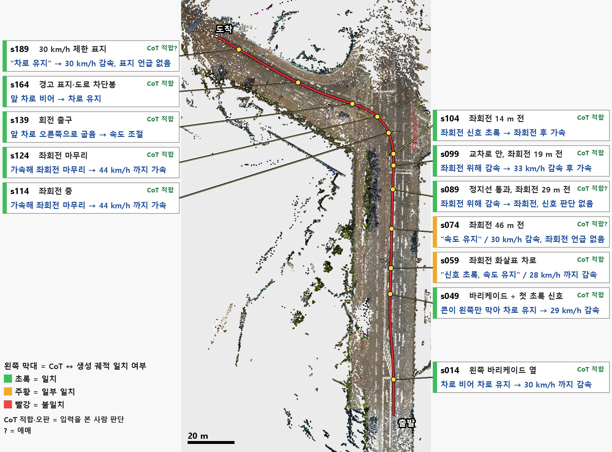

```빨강 선 = 실제 주행, 노랑 점 = 평가 시점, 배경 = 2DGS 맵을 위에서 본 모습 ```

---

## 3. 시점별 결과

### 3.1 공사 바리케이드 구간

#### s014 — 왼쪽 바리케이드 옆

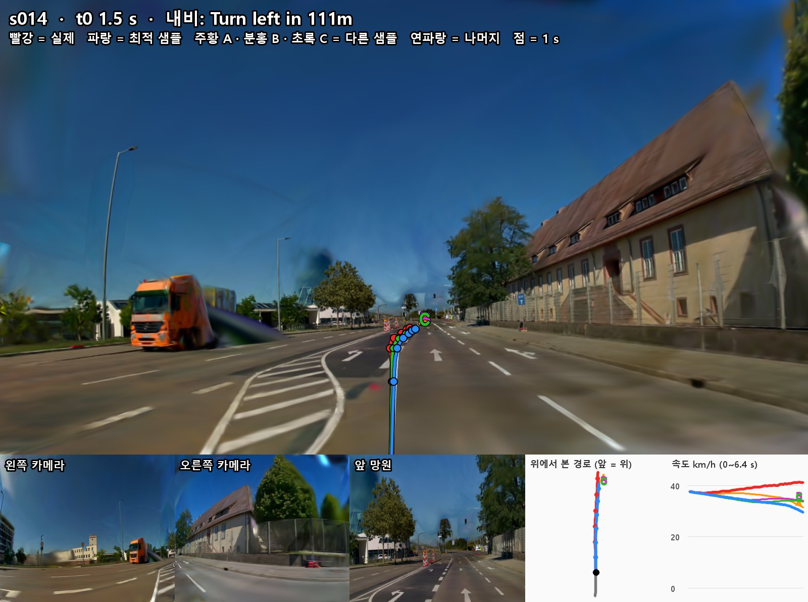

**최적 샘플 (파랑)**
- **CoT**: `Keep lane to continue since the lane is clear`
- **번역**: 차로가 비어 있어 차로 유지
- **CoT 적합성: 적합**
  - 차선 번경 진행 중인 좌회전 차로 앞이 비어 있음.
- **생성 궤적: 일치**
  - 차선 변경 유지, 38 -> 30 km/h 감속

**다른 예측**

| 예측 | CoT | CoT 적합성 | 생성 궤적 |
|---|---|---|---|
| A (주황) | `Nudge to the right to clear the construction cones blocking the center of our lane` (차로 가운데를 막은 공사 콘을 피해 오른쪽으로 살짝 비킴) | **적합(애매)**<br>공사 콘은 차로 가운데가 아니라 왼쪽 이중선 위에 있음 | **일치**<br>공사 콘을 피해 주행 |
| B (분홍) | `Keep lane since construction cones are closing the left lane but our lane remains clear` (공사 콘이 왼쪽 차로를 닫지만 우리 차로는 비어 있어 차로 유지) | **적합(애매)**<br>우리 차로는 비어 있음. 다만 공사 콘은 왼쪽 차로 바깥 선 위라 왼쪽 차로를 닫지는 않음 | **일치**<br>차로 유지, 34 km/h 까지 감속 |
| C (초록) | `Lane change to the left due to construction cones blocking the current lane ahead` (앞 우리 차로를 막은 공사 콘 때문에 왼쪽으로 차로 변경) | **오판**<br>우리 차로는 비어 있음 | **일치**<br>공사 콘을 피해 주행 |

#### s049 — 바리케이드 + 첫 초록 신호

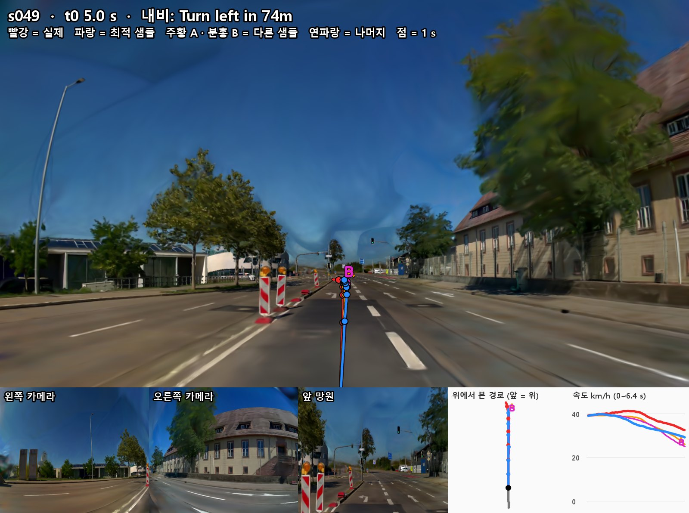

**최적 샘플 (파랑)**
- **CoT**: `Keep lane since construction cones block the left lane but our lane remains clear`
- **번역**: 공사 콘이 왼쪽 차로를 막지만 우리 차로는 비어 있어 차로 유지
- **CoT 적합성: 적합**
  - 바리케이드는 중앙분리대 쪽 왼쪽 선 위에 있고 우리 좌회전 화살표 차로는 비어 있음
- **생성 궤적: 일치**
  - 차로 유지, 40 km/h 까지 가속 후 29 km/h 감속

**다른 예측**

| 예측 | CoT | CoT 적합성 | 생성 궤적 |
|---|---|---|---|
| A (주황) | `Keep speed through the intersection since the traffic light is green` (신호가 초록이라 속도 유지하며 교차로 통과) | **적합**<br>앞 신호는 초록. 다만 교차로가 74 m 앞이고 내비 좌회전 언급 없음 | **불일치**<br>"속도 유지"인데 39 -> 26 km/h 감속 |
| B (분홍) | `Nudge to the right to clear the construction cones blocking the left side of our lane` (공사 콘이 우리 차로 왼쪽을 막고 있어 오른쪽으로 살짝 비킴) | **적합(애매)**<br>바리케이드가 왼쪽 선 바로 위라 옆 간격을 넓히는 판단은 타당. 다만 차로 안을 막지는 않음 | **일치**<br>살짝 오른쪽으로 주행 |

### 3.2 좌회전 접근

#### s059 — 좌회전 화살표 차로

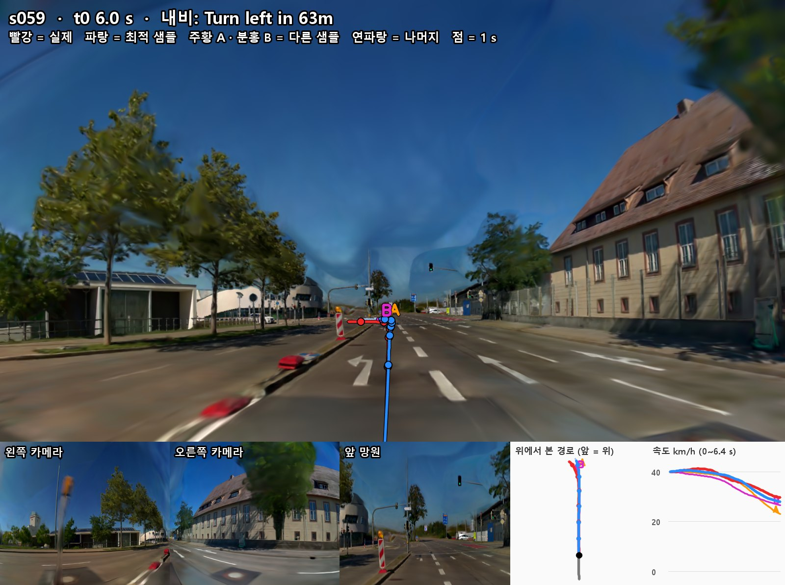

**최적 샘플 (파랑)**
- **CoT**: `Keep speed through the intersection since the traffic light is green`
- **번역**: 신호가 초록이라 속도 유지하며 교차로 통과
- **CoT 적합성: 적합**
  - 앞 신호가 초록이라 통과 가능 
- **생성 궤적: 일부**
  - 28 km/h 까지 감속해 문장의 "속도 유지"와 다름. 다만, 좌회전 내비를 반영하였다면 좌회전을 위한 감속으로는 적합

**다른 예측**

| 예측 | CoT | CoT 적합성 | 생성 궤적 |
|---|---|---|---|
| A (주황) | 최적 샘플과 같은 문장 | **적합**<br>최적 샘플과 같음 | **일부**<br>최적 샘플과 같음 |
| B (분홍) | `Accelerate to proceed through the intersection since the straight traffic light is green` (직진 신호가 초록이라 가속해 교차로 통과) | **오판**<br>좌회전을 해야하는데 직진으로 판단 | **불일치**<br>"가속"인데 27 km/h 까지 감속 |

#### s074 — 좌회전 46 m 전

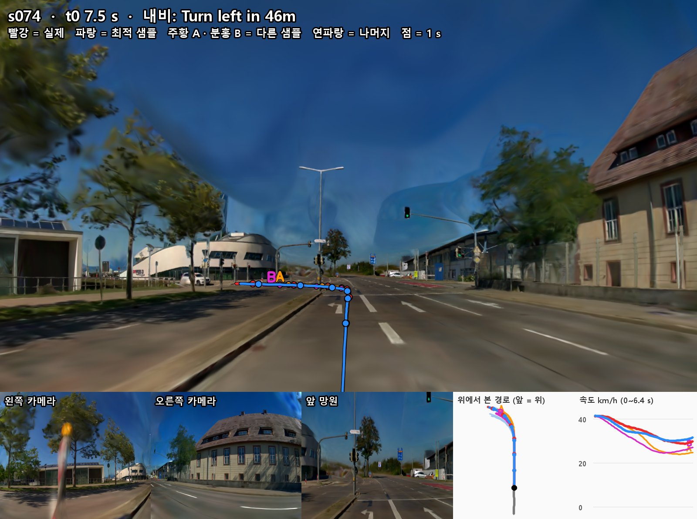

**최적 샘플 (파랑)**
- **CoT**: `Keep speed through the intersection since the traffic light is green`
- **번역**: 신호가 초록이라 속도 유지하며 교차로 통과
- **CoT 적합성: 적합(애매)**
  - 머리 위 신호는 초록. 다만, 좌회전 언급 없음
- **생성 궤적: 일부**
  - "속도 유지"인데 30 km/h 까지 감속 -> **내비 좌회전은 생성 궤적에만 반영, CoT 에는 반영 안 됨**

**다른 예측**

| 예측 | CoT | CoT 적합성 | 생성 궤적 |
|---|---|---|---|
| A (주황) | 최적 샘플과 같은 문장 | **적합(애매)**<br>최적 샘플과 같음 | **일부**<br>최적의 샘플과 비슷 |
| B (분홍) | `Accelerate to proceed through the intersection since the straight traffic light is green` (직진 신호가 초록이라 가속해 교차로 통과) | **오판**<br>좌회전 차로인데 직진으로 판단 | **불일치**<br>"가속·직진"인데 25 km/h 까지 감속 후 왼쪽 11.7 m 좌회전 |

#### s089 — 정지선 통과, 좌회전 29 m 전

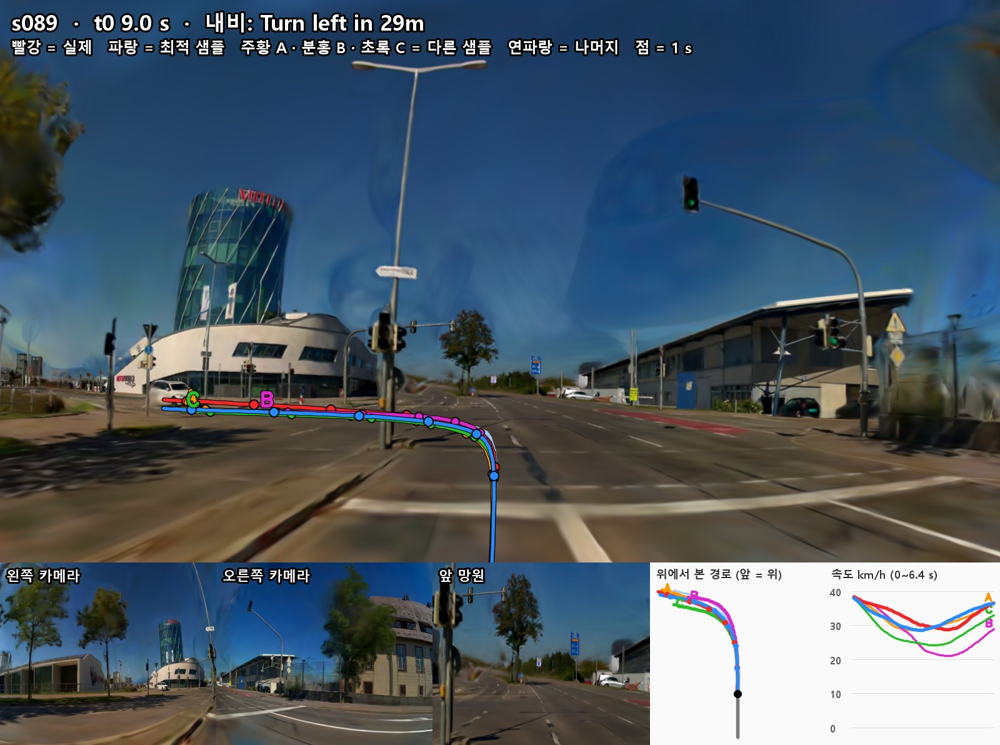

**최적 샘플 (파랑)**
- **CoT**: `Reduce speed to turn left at the intersection`
- **번역**: 교차로에서 좌회전하려고 감속
- **CoT 적합성: 적합(애매)**
  - 좌회전은 내비·노면 화살표와 맞음. 다만, 신호 판단 없음
- **생성 궤적: 일치**
  - 29 km/h 까지 감속하며 좌회전

**다른 예측**

| 예측 | CoT | CoT 적합성 | 생성 궤적 |
|---|---|---|---|
| A (주황) | `Keep speed through the intersection since the traffic light is green` (신호가 초록이라 속도 유지하며 교차로 통과) | **적합(애매)**<br>머리 위 신호 초록. 좌회전 언급 없음 | **일부**<br>좌회전. "속도 유지"인데 29 km/h 까지 감속 |
| B (분홍) | `Slow down due to the upcoming left curve in the road` (앞 왼쪽 곡선 도로 때문에 감속) | **오판(애매)**<br>앞은 곡선 도로가 아니라 교차로 좌회전 | **일치**<br>21 km/h 까지 감속 |
| C (초록) | `Accelerate to proceed through the intersection since the straight traffic light is green` (직진 신호가 초록이라 가속해 교차로 통과) | **오판**<br>좌회전 차로·내비 좌회전인데 직진 판단 | **불일치**<br>"가속·직진"인데 24 km/h 까지 감속 후 좌회전 |

### 3.3 교차로 안 좌회전

#### s099 — 교차로 안, 좌회전 19 m 전

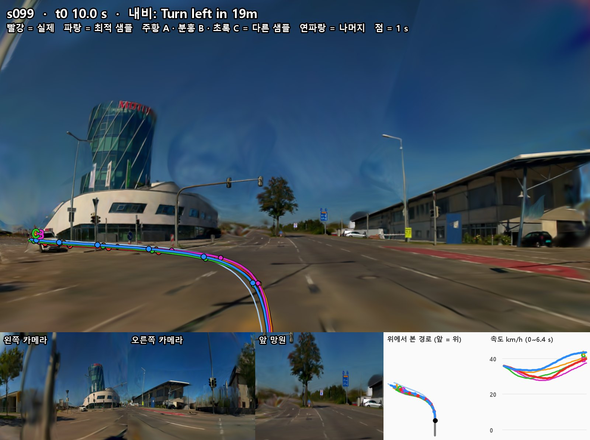

**최적 샘플 (파랑)**
- **CoT**: `Reduce speed to turn left at the intersection`
- **번역**: 교차로에서 좌회전하려고 감속
- **CoT 적합성: 적합**
  - 교차로 안이고 내비 좌회전과 맞음
- **생성 궤적: 일치**
  - 좌회전 시 33 km/h 까지 줄인 뒤 43 km/h 로 다시 가속

**다른 예측**

| 예측 | CoT | CoT 적합성 | 생성 궤적 |
|---|---|---|---|
| A (주황) | `Turn right at the intersection since the right-turn traffic light is green` (우회전 신호가 초록이라 교차로에서 우회전) | **오판**<br>내비는 좌회전이고 우리 방향 신호는 화면에 안 보임 | **불일치**<br>판단은 "우회전"인데 좌회전 -> **CoT 와 반대 방향** |
| B (분홍) | `Slow down due to red traffic light ahead` (앞 빨간 신호 때문에 감속) | **오판**<br>왼쪽 건너편 기둥의 작은 신호가 붉게 보이나 이미 교차로 안이고 우리 방향 신호인지 구분 안 됨 | **불일치**<br>28 km/h 까지 감속하나 정지 안 하고 좌회전 |
| C (초록) | `Accelerate to proceed through the intersection since the straight traffic light is green` (직진 신호가 초록이라 가속해 교차로 통과) | **오판**<br>좌회전 중인데 직진 판단 | **불일치**<br>감속 후 좌회전 |


#### s104 — 좌회전 14 m 전

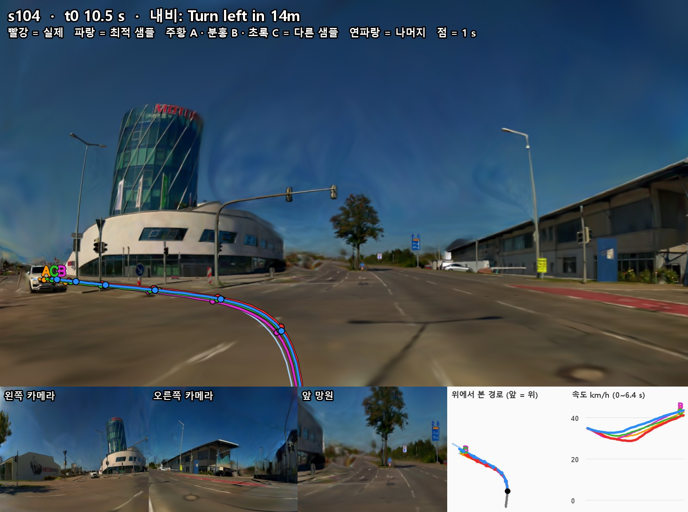

**최적 샘플 (파랑)**
- **CoT**: `Turn left at the intersection since the left-turn traffic light is green`
- **번역**: 좌회전 신호가 초록이라 교차로에서 좌회전
- **CoT 적합성: 적합**
  - 좌회전은 맞음. 다만 이미 교차로 안이라 우리 방향 신호가 화면에 안 보임
- **생성 궤적: 일치**
  - 좌회전 후 가속

**다른 예측**

| 예측 | CoT | CoT 적합성 | 생성 궤적 |
|---|---|---|---|
| A (주황) | `Slow down due to red traffic light ahead` (앞 빨간 신호 때문에 감속) | **오판(애매)**<br>왼쪽 건너편 기둥의 작은 신호가 붉게 보이나 이미 교차로 안이고 우리 방향 신호인지 구분 안 됨 | **불일치**<br>"감속"인데 43 km/h 까지 가속|
| B (분홍) | `Accelerate to proceed through the intersection since the straight traffic light is green` (직진 신호가 초록이라 가속해 교차로 통과) | **오판**<br>좌회전 중인데 직진 판단 | **불일치**<br>좌회전 후 가속|
| C (초록) | `Turn right at the intersection since the right-turn traffic light is green` (우회전 신호가 초록이라 교차로에서 우회전) | **오판**<br>좌회전을 해야 하고 신호는 화면에 안 보임 | **불일치**<br>"우회전"인데 좌회전 -> **CoT 와 반대 방향** |

#### s114 — 좌회전 중

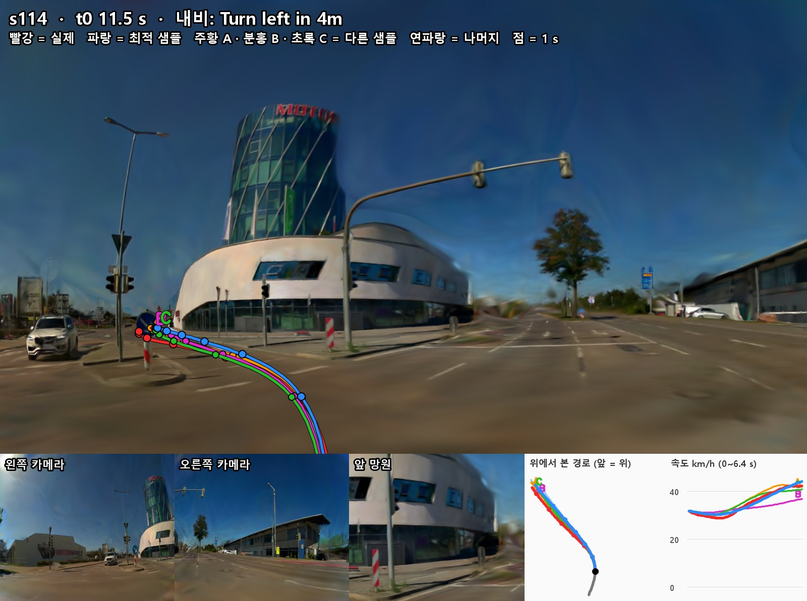

**최적 샘플 (파랑)**
- **CoT**: `Accelerate to complete the left turn through the intersection`
- **번역**: 가속해 좌회전 마무리
- **CoT 적합성: 적합**
- **생성 궤적: 일치**
  - 좌회전 후, 44 km/h 까지 가속

**다른 예측**

| 예측 | CoT | CoT 적합성 | 생성 궤적 |
|---|---|---|---|
| A (주황) | `Reduce speed to turn left at the intersection` (교차로에서 좌회전하려고 감속) | **적합**<br>좌회전 중이라 속도를 낮추는 판단은 타당 | **불일치**<br>"감속"인데 43 km/h 까지 가속 |
| B (분홍) | `Slow down due to the left curve at the intersection` (교차로의 왼쪽 굽은 길 때문에 감속) | **적합**<br>좌회전 중이라 속도를 낮추는 판단은 타당 | **일부**<br>31 km/h 까지 줄인 뒤 37 km/h 로 회전 |
| C (초록) | `Adjust speed and keep safe distance due to the vehicle ahead` (앞차 때문에 속도 조절하며 안전거리 유지) | **오판**<br>렌더 입력에는 앞차가 없음 (왼쪽 SUV 는 차로 밖 정차) | **불일치**<br>"간격 유지"인데 41 km/h 까지 가속 |

#### s124 — 좌회전 마무리

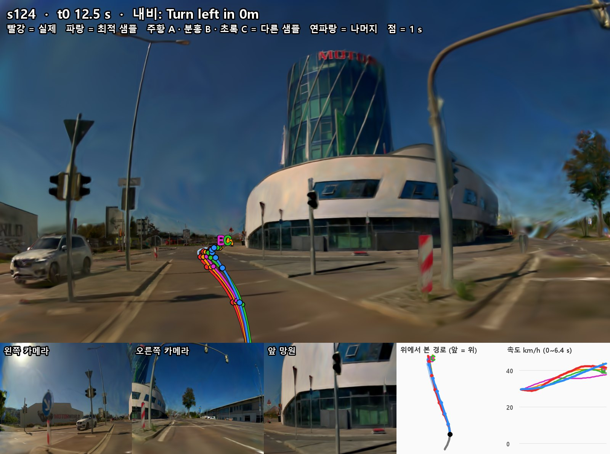

**최적 샘플 (파랑)**
- **CoT**: `Accelerate to complete the left turn through the intersection`
- **번역**: 가속해 좌회전 마무리
- **CoT 적합성: 적합**
  - 회전 출구 앞 차로가 비어 있음
- **생성 궤적: 일치**
  - 44 km/h 까지 가속 

**다른 예측**

| 예측 | CoT | CoT 적합성 | 생성 궤적 |
|---|---|---|---|
| A (주황) | `Adjust speed and keep safe distance due to the vehicle ahead` (앞차 때문에 속도 조절하며 안전거리 유지) | **오판**<br>렌더 입력에는 앞차가 없음 (왼쪽 SUV 는 차로 밖 정차) | **불일치**<br>"간격 유지"인데 41 km/h 까지 가속 |
| B (분홍) | `Slow down due to the left curve at the intersection` (교차로의 왼쪽 굽은 길 때문에 감속) | **적합**<br>아직 회전 중 | **불일치**<br>"감속"인데 38 km/h 까지 가속 |
| C (초록) | `Keep lane since the lane is clear ahead` (앞 차로가 비어 차로 유지) | **적합**<br>차로가 비어 있음 | **일치**<br>40 km/h로 가속 |

### 3.4 회전 뒤 직진

#### s139 — 회전 출구

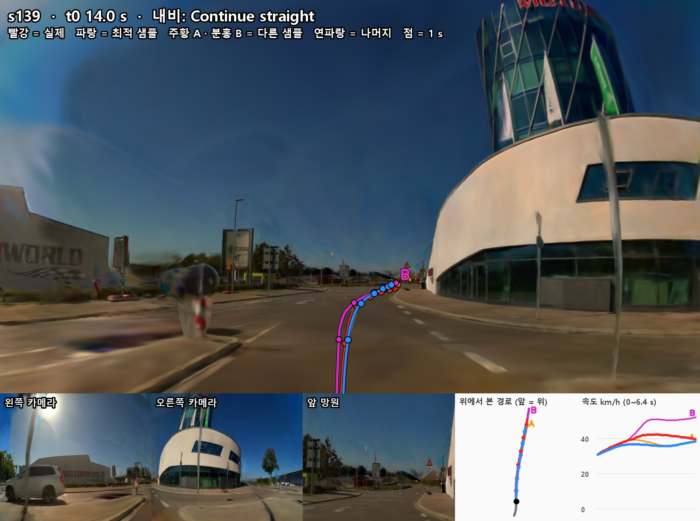

**최적 샘플 (파랑)**
- **CoT**: `Adapt speed for the right curve since the lane bends right ahead`
- **번역**: 앞 차로가 오른쪽으로 굽어 속도 조절
- **CoT 적합성: 적합**
  - 회전 출구 뒤 도로가 오른쪽으로 굽음
- **생성 궤적: 일치**
  

**다른 예측**

| 예측 | CoT | CoT 적합성 | 생성 궤적 |
|---|---|---|---|
| A (주황) | `Keep lane since the lane is clear after the right turn` (오른쪽으로 돈 뒤 차로가 비어 차로 유지) | **적합(애매)**<br>앞 차로는 비어 있고 오른쪽으로 굽음. 다만 방금 마친 회전은 좌회전 | **일치** |
| B (분홍) | `Keep lane since the lane is clear ahead` (앞 차로가 비어 차로 유지) | **적합**<br> | **일치**<br>다만 52 km/h 까지 가속 |

#### s164 — 경고 표지·도로 차단봉

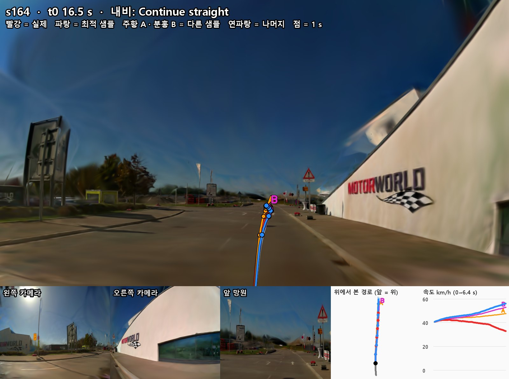

**최적 샘플 (파랑)**
- **CoT**: `Keep lane since the lane is clear ahead`
- **번역**: 앞 차로가 비어 차로 유지
- **CoT 적합성: 적합**
  - 앞 차로가 비어 있고, 오른쪽 차단봉·받침은 가장자리 선 바깥에 있음
- **생성 궤적: 일치**
  - 차로 유지 

**다른 예측**

| 예측 | CoT | CoT 적합성 | 생성 궤적 |
|---|---|---|---|
| A (주황) | `Adapt speed for the right curve since the lane bends right ahead` (앞 차로가 오른쪽으로 굽어 속도 조절) | **오판**<br>앞 길이 거의 곧게 이어져 오른쪽 곡선이 뚜렷하지 않음 | **일부**<br>"속도 조절"인데, 48 km/h 까지 가속|
| B (분홍) | `Nudge left due to cones blocking the right side of our lane` (콘이 우리 차로 오른쪽을 막고 있어 왼쪽으로 살짝 비킴) | **오판**<br>오른쪽 빨강·흰 차단봉과 붉은 받침은 가장자리 선 바깥이라 우리 차로를 막지 않음 | **불일치**<br>왼쪽 이동 없음, 53 km/h 까지 가속 |


#### s189 — 30 km/h 제한 표지

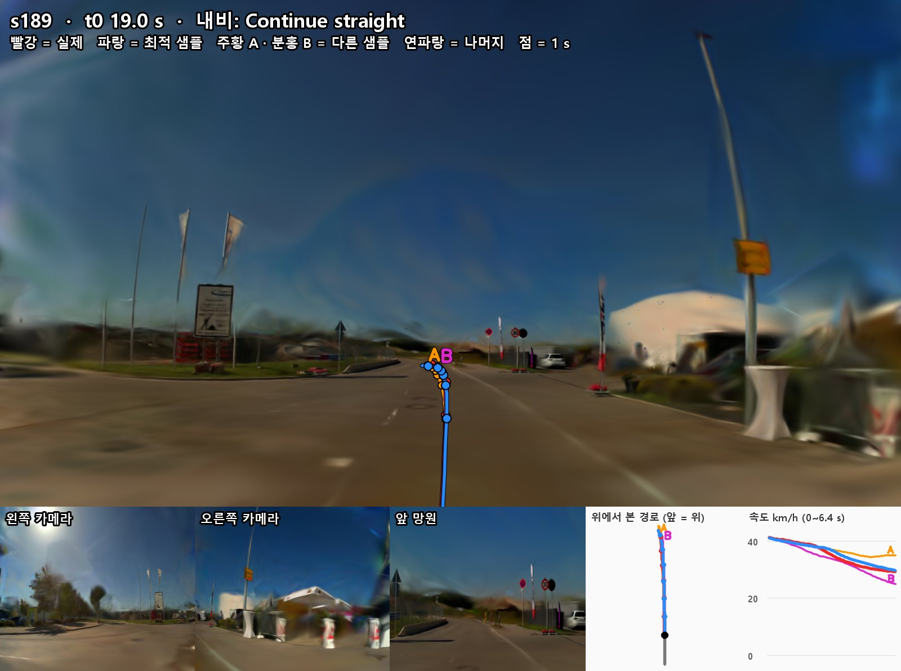

**최적 샘플 (파랑)**
- **CoT**: `Keep lane since the lane is clear ahead`
- **번역**: 앞 차로가 비어 차로 유지
- **CoT 적합성: 적합(애매)**
  - 앞 차로는 비어 있음. 다만 앞 30 km/h 제한 표지 언급 없음
- **생성 궤적: 일치**
  - 41 -> 30 km/h 감속 -> **제한 표지에 맞는 감속은 생성 궤적에만 반영, CoT 에는 반영 안 됨**

**다른 예측**

| 예측 | CoT | CoT 적합성 | 생성 궤적 |
|---|---|---|---|
| A (주황) | `Adapt speed for the right curve since the lane bends right ahead` (앞 차로가 오른쪽으로 굽어 속도 조절) | **오판**<br>앞 길은 왼쪽으로 살짝 굽음 | **불일치**<br>"오른쪽"으로 굽었다 판단했는데, 왼쪽으로 이동 |
| B (분홍) | 최적 샘플과 같은 문장 | **적합(애매)**<br>최적 샘플과 같음 | **일치**<br>25 km/h 까지 감속 |
