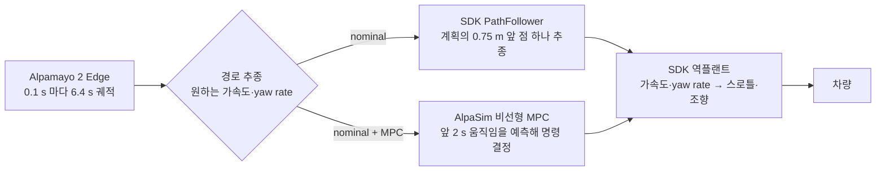
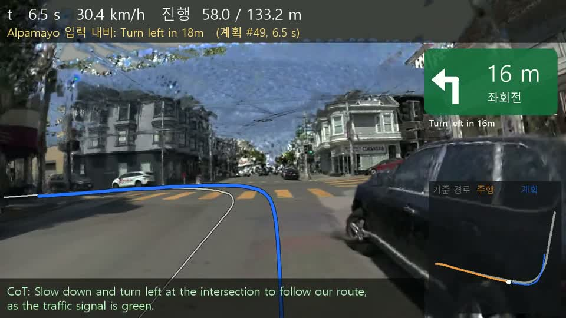
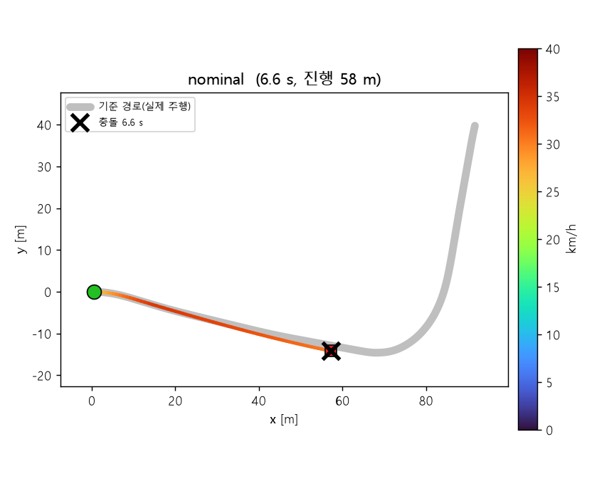
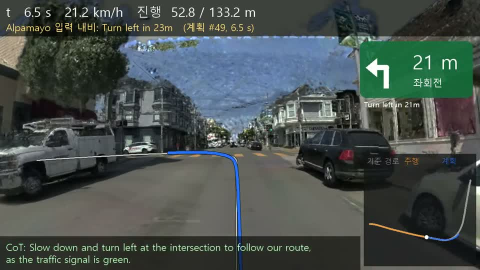
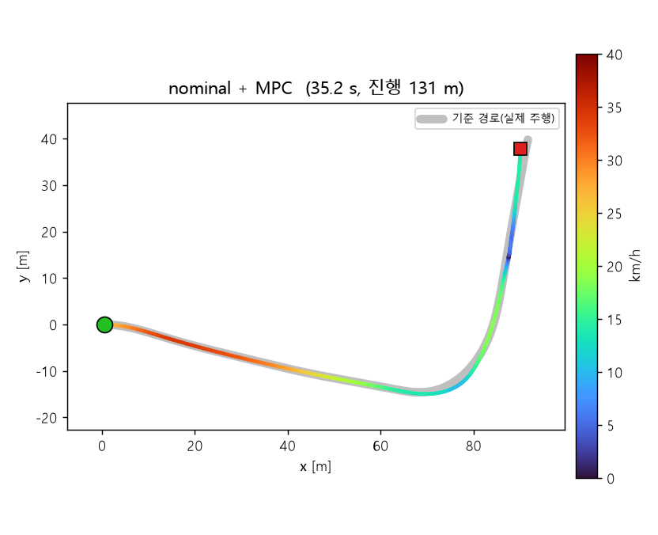

# 2DGS 맵 Alpamayo 2 Edge closed-loop — nominal vs nominal + MPC

## 1. 개요

| 항목 |  |
|---|---|
| 지난 보고 | 10 Hz 재계획에서 **주행 초반에 차가 오른쪽으로 틀어짐** -> AlpaSim 처럼 MPC 제어기를 적용해 처음부터 10 Hz 로 주행하는 실험 진행, 결과가 좋으면 기존 nominal 제어기에 MPC 기능을 적용해 실험할 계획 |
| 이번 | nominal 에 AlpaSim MPC 기능 적용 -> nominal vs nominal + MPC closed-loop 결과 |
| 맵 | PhysicalAI-AV 클립 058bf960 (샌프란시스코) 2DGS 맵 + 노면 메시, 경로 133.2 m (직진 후 교차로 좌회전) |
| 모델 | Alpamayo 2 Edge (2B), 0.1 s 마다 재계획 (10 Hz), 시드 42 |
| 입력 | 6캠 (왼쪽·앞·오른쪽 광각 + 후방 2 + 앞 망원, 실제 카메라 모델로 렌더), 이력 궤적, 내비 문장 |
| 차량 | Genesis 차량 (1450 kg, 축거 2.41 m, 최대 조향 0.6 rad) |
| 시작 | 0 ~ 1.6 s 는 실제 주행을 그대로 재생 (AlpaSim `force_gt` 방식) -> 1.6 s 부터 모델 계획으로 주행 |


---

## 2. nominal 에 추가한 MPC 기능



| 항목 | nominal | nominal + MPC |
|---|---|---|
| 경로 추종 | SDK PathFollower | AlpaSim 비선형 MPC |
| 계획에서 보는 범위 | 0.75 m 앞 점 하나 | 앞 2 s (0.1 s 간격 20 점) |
| 맞추려는 부분 | 그 한 점 -> 계획 맨 앞부분 | **1 ~ 2 s 구간** (앞 1 s 는 계획과 어긋나도 상관 안 함) |
| 명령 정하는 법 | 그 점 방향으로 조향, 그 점 속도와의 차이만큼 가감속 | 차량 모델로 앞 2 s 동안 차가 움직일 경로를 예측 -> 그 경로가 계획과 가장 가까워지는 명령을 찾음 -> 첫 0.1 s 명령만 쓰고 0.1 s 뒤 다시 계산 |


- 핵심은 **앞 1 s 무시**: nominal 은 계획 맨 앞부분(오른쪽으로 살짝 휜 부분)을 그대로 따라감 -> 0.1 s 마다 새 계획이 그 자리에서 다시 휨 -> 오른쪽으로 쌓임.   
```But, MPC 는 1 ~ 2 s 쪽에 맞추므로 앞부분의 휨이 쌓이지 않음```

---

## 3. 결과

### 3.1 주행 영상


| 제어기 | 주행 영상 (클릭) | &nbsp;&nbsp;&nbsp;&nbsp;&nbsp;&nbsp;&nbsp;&nbsp;&nbsp;&nbsp;&nbsp;&nbsp;&nbsp;&nbsp;&nbsp;&nbsp;&nbsp;&nbsp;&nbsp;&nbsp;&nbsp;&nbsp;&nbsp;&nbsp;&nbsp;&nbsp;&nbsp;&nbsp;&nbsp;&nbsp;&nbsp;&nbsp;&nbsp;&nbsp;&nbsp;&nbsp;&nbsp;&nbsp;&nbsp;&nbsp;경로&nbsp;(속도색)&nbsp;&nbsp;&nbsp;&nbsp;&nbsp;&nbsp;&nbsp;&nbsp;&nbsp;&nbsp;&nbsp;&nbsp;&nbsp;&nbsp;&nbsp;&nbsp;&nbsp;&nbsp;&nbsp;&nbsp;&nbsp;&nbsp;&nbsp;&nbsp;&nbsp;&nbsp;&nbsp;&nbsp;&nbsp;&nbsp;&nbsp;&nbsp;&nbsp;&nbsp;&nbsp;&nbsp;&nbsp;&nbsp;&nbsp;&nbsp; |
|---|---|---|
| nominal | <a href="https://github.com/user-attachments/assets/6bb15318-510b-4419-8549-f51b2aa2e557"></a> |  |
| nominal + MPC | <a href="https://github.com/user-attachments/assets/e9be164d-397b-4a4f-ad7a-f2f515ed3b59"></a> |  |

- 6.5 s: nominal 은 오른쪽 주차 SUV 에 충돌, nominal + MPC 는 차로 가운데  
 : 같은 시각 CoT 는 둘 다 `Slow down and turn left at the intersection to follow our route, as the traffic signal is green`
- 같은 판단을 받아도 계획 앞부분을 그대로 따라가면 오른쪽으로 밀림 -> 제어기 쪽 문제

- nominal + MPC 의 107 m 지점 정지 구간 (21.5 ~ 25.5 s). 앞 오른쪽 연석에 **렌더가 깨진 반투명 물체**(2DGS 에 제대로 복원 안 된 물체, 바닥에 빨간 번짐)
  - CoT 가 이 물체를 `parked vehicle`, `dumpster`, `construction barriers`, `truck and trailer` 로 읽음 -> `Remain stopped as the stationary vehicle ahead obstructs our lane` (앞 정지 차량이 차로를 막아 정지 유지)
  
  - 25.5 s `Accelerate and steer left to pull out from the curb` (가속하며 왼쪽으로 빠져나감) -> 옆 차로로 바꿔 출발 -> **렌더 결함(깨진 물체·파인 노면)을 모델이 장애물로 보고 선 것**


### 3.2 지표


| | nominal | nominal + MPC |
|---|---|---|
| 결과 | **6.6 s 오른쪽 주차 SUV 와 충돌** -> 종료 | 완주 (35.2 s) |
| 진행 | 58.4 / 133.2 m | 130.8 / 133.2 m |
| 기준 경로 횡거리 평균 / 최대 (0 ~ 58.4 m, nominal 충돌 지점까지) | 0.44 / 1.27 m | **0.03 / 0.10 m** |
| 기준 경로 횡거리 평균 / 최대 (전 구간) | - | 0.31 / 1.13 m |
| 계획 1 s 뒤 예측 위치와 실제 위치 횡차 (1.6 ~ 5.7 s) | 0.104 m | **0.033 m** |
| yaw rate 표준편차 (1.6 ~ 6.6 s) | 0.5 °/s | 1.0 °/s |

- 횡거리 = 실제 주행 궤적에서 옆으로 벗어난 거리 (+ 왼쪽, − 오른쪽)

---

## 4. 정리

- nominal 에 AlpaSim MPC 기능(앞 1 s 무시, 2 s 지평) 적용 -> 초반 오른쪽 누적 없어짐
- 이후 실험은 **nominal + MPC** 를 기본 제어기로 사용

---

## 5. genesis_vehicle SDK 결함 (v1.6.10, 최신)

| 결함 | 증상 | 실측 | 지금 우회 |
|---|---|---|---|
| **구름저항 (rolling resistance)** | `RollingResistance` 훅에 계수 0.015 를 넣어도 감속이 없음. 훅이 뺀 바퀴 힘을 뒤의 마찰 클램프가 자유 굴림에서 0 으로 되돌림 | 스로틀·브레이크 0 타행 감속 5 / 10 / 15 m/s 모두 **0.000 m/s²** (기대 0.147) | 구름저항을 차체 힘으로 직접 더함 -> 0.126 / 0.142 / 0.170 m/s² |
| 역플랜트 포화 출발점 | 역플랜트는 직전 명령에서 선형화 -> 직전 명령이 ±1 이면 기울기 0 이라 반대쪽 해를 못 찾음 | −2 m/s 후진 중 +3 m/s² 요구에 스로틀 −1 그대로 (직전 0 이면 +0.74 정상) | 직전 명령이 ±1 이면 0 에서도 풀어 오차가 작은 해 사용 |

- 구름저항: 타이어가 굴러가며 생기는 저항. SDK 에 이 기능이 있지만 켜도 실제로는 안 걸림 

- 역플랜트: 원하는 가속도를 내려면 스로틀을 얼마나 밟을지 계산하는 부분. SDK 는 주행 중 브레이크 대신 반대쪽 스로틀로 감속함
  - 직전에 스로틀을 끝(±1)까지 밟았으면 반대로 밟아야 할 때도 계속 끝까지 밟으라고 답함 (예: 후진을 멈춰야 하는데 후진 스로틀 유지)
  - 직전 명령이 끝이면 0 에서 다시 계산해 더 맞는 답을 쓰도록 우회


