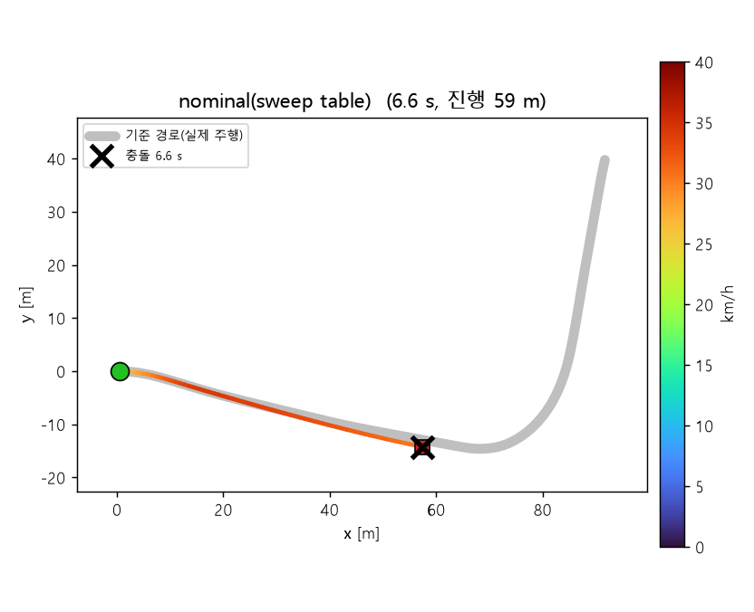
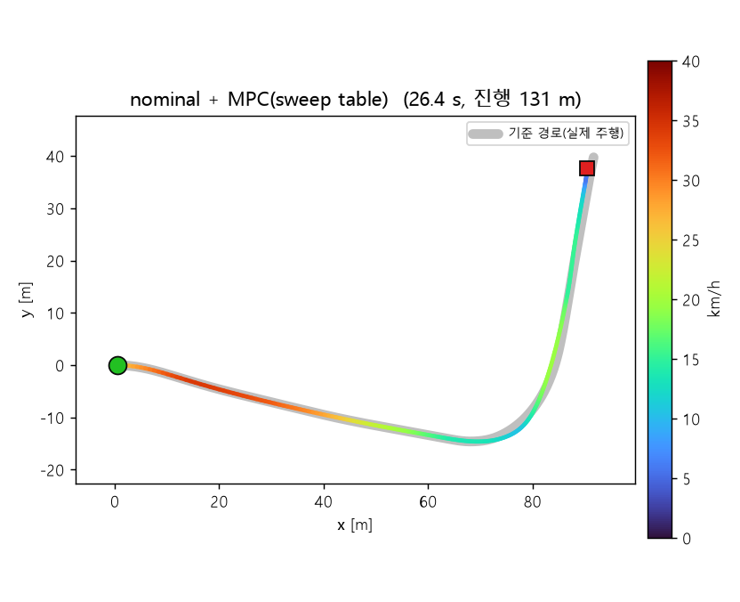

# Nominal SweepTable ComputeTime

## 1. 개요

| 항목 |  |
|---|---|
| 이번 | nominal 의 스로틀·조향 계산을 DifferentiablePlant → **sweep table** 로 전환 -> nominal vs nominal + MPC 계산 시간·2DGS 맵 closed-loop 비교 |
| 표기 | `(sweep table)` 미리 잰 표에서 찾기, `(DifferentiablePlant)` 매 스텝 차 물리 모델 미분 |
| 계산 시간 (2절) | genesis_vehicle SDK **L1** (차 1 대), L2·L3 없음, CPU. 제어 주기 25 ms, 같은 경로 (직선 + 좌회전 67 m) 10 s × 3 회 |
| closed-loop (3절) | 26-11-15 보고서와 같은 설정 (2DGS 맵, Alpamayo 2 Edge), 바뀐 것은 스로틀·조향 계산 방법만 |

---

## 2. 제어 한 스텝 계산 시간

### 2.1 계산 시간 (제어 주기 25 ms)

| 제어기 | 평균 | 중앙값 | 상위 5 % | 최대 | 25 ms 넘은 스텝 |
|---|---|---|---|---|---|
| **nominal(sweep table)** | **0.33 ms** | 0.32 | 0.38 | 0.71 | 0 % |
| nominal(DifferentiablePlant) | 19.2 ms | 18.7 | 21.2 | 40.9 | 1.1 % |
| **nominal + MPC(sweep table)** | **3.7 ms** | 0.33 | 16.8 | 22.6 | 0 % |
| nominal + MPC(DifferentiablePlant) | 18.9 ms | 15.5 | 33.1 | 56.2 | 25.7 % |

### 2.2 같은 경로 추종 오차 (3 회 평균)

| 제어기 | 경로 횡거리 평균 / 최대 | 목표 속도와 차이 평균 |
|---|---|---|
| nominal(sweep table) | 0.098 / 0.19 m | 0.08 m/s |
| nominal(DifferentiablePlant) | 0.103 / 0.20 m | 0.08 m/s |
| nominal + MPC(sweep table) | 0.050 / 0.28 m | 0.43 m/s |
| nominal + MPC(DifferentiablePlant) | 0.057 / 0.33 m | 0.41 m/s |

- 횡거리 = 경로에서 옆으로 벗어난 거리

---

## 3. 2DGS 맵 closed-loop — nominal vs nominal + MPC (sweep table)

### 3.1 경로 (속도색)

| nominal(sweep table) | nominal + MPC(sweep table) |
|---|---|
|  |  |

### 3.2 지표

| | **nominal(sweep table)** | **nominal + MPC(sweep table)** | 참고: nominal(DifferentiablePlant) | 참고: nominal + MPC(DifferentiablePlant) |
|---|---|---|---|---|
| 결과 | **6.6 s 오른쪽 주차 차와 충돌** -> 종료 | 완주 | 6.6 s 충돌 | 완주 |
| 진행 | 58.8 / 133.2 m | 131.2 / 133.2 m | 58.4 m | 131.2 m |
| 기준 경로 횡거리 평균 / 최대 (0 ~ 58.4 m) | 0.44 / 1.30 m | **0.03 / 0.09 m** | 0.44 / 1.28 m | 0.03 / 0.10 m |
| 기준 경로 횡거리 평균 / 최대 (전 구간) | - | 0.33 / 0.89 m | - | 0.31 / 1.13 m |
| 계획 1 s 뒤 예측 위치와 실제 위치 횡차 (1.6 ~ 5.7 s) | 0.104 m | **0.025 m** | 0.104 m | 0.033 m |
| yaw rate 표준편차 (1.6 ~ 6.6 s) | 0.4 °/s | 0.7 °/s | 0.5 °/s | 1.0 °/s |
